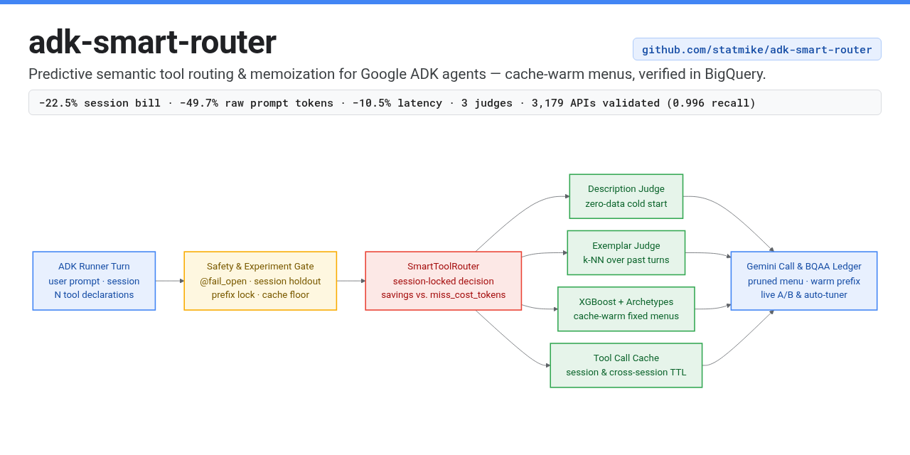
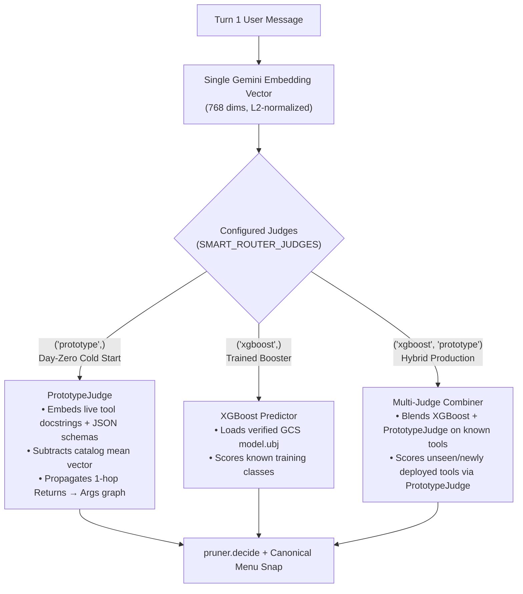
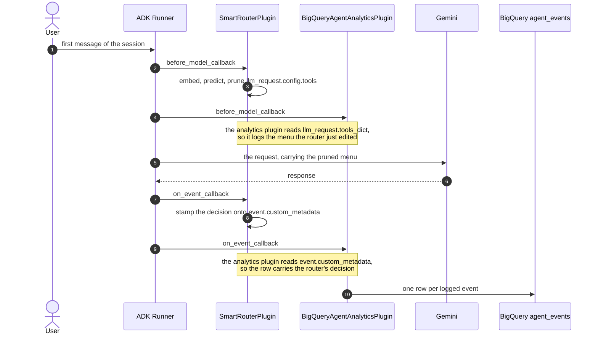
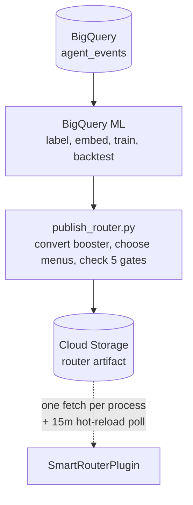

# adk-smart-router

A predictive semantic router for [Google ADK](https://adk.dev/) agents. It does two things: it
prunes the tool menu once per session based on what the user asked for, and it skips tool calls
whose answer it already has.

Both are aimed at the same problem. An agent with fifty tools sends all fifty declarations to the
model on every turn, whether the user asked about a refund or the weather. The declarations cost
tokens, and a long menu costs accuracy, because the model has more wrong answers to choose from.



## Status

It works, and the saving is measured rather than projected.

The headline comes from a live A/B: 600 sessions and 1,894 turns of a 100-tool customer support
agent, half routed and half with the router uninstalled, for $12.72. The run is real, and the
conversations in it are not. Every model call, every billed token and every cache hit below was
actually incurred, and the arm split was made by the shipped code rather than by the test harness,
but the user turns were written by this project because there is no production traffic to use yet.
Read it as a measurement on authored traffic. The plugin ships with the same holdout arm enabled,
so the first number from real users comes from an adopter running `report_ab.py` on their own.

| | routed against control |
| --- | --- |
| billed input tokens per turn | **−23.4%** |
| the whole bill per session, input and output, unnormalised | **−22.5%** |
| latency | −10.5% |
| turns per session | +0.7%, p = 0.74 |

The two savings differ only by that turn count, which is the first direct evidence that a pruned
menu does not cost an agent extra rounds. Quality did not move either. Both arms called a tool in
the same share of sessions, made the same number of calls per session, reached about the same
number of distinct tools, and sent the same share of calls into the long tail. A router hiding
tools people needed would show up as a shorter tail, and it does not.

**Read −22.5% as a floor.** Raw prompt tokens fell 49.7%, and the whole gap between that and the
bill is the cache. [Gemini Enterprise Agent
Platform](https://cloud.google.com/gemini-enterprise-agent-platform/generative-ai/pricing) charges
a tenth as much for a [cached input
token](https://docs.cloud.google.com/gemini-enterprise-agent-platform/models/context-cache/context-cache-overview),
so the declarations the router removes were already nearly free: you save a tenth of what you remove, and only while
the cache keeps hitting. The A/B's control arm sends one tool list, so all 289 of its sessions
keep one prefix warm; the routed arm splits its sessions over 24 menus, so each menu mostly waits.
That is the experiment's shape rather than the router's. Repricing every routed opening at the
warmth the routed arm itself reaches when a menu is busy reads **32.1%**, and closing the rest of
the gap would read 42.4% as an upper bound. Denser traffic per menu is what moves the number up
that range, which is why the router sends one of a few fixed menus rather than a bespoke set per
session.

**The worst case has been run too.** An agent small enough that pruning carries its shared prefix
under the model's cache floor can never open a session warm. Twelve sessions of one confirm it:
turn one cached exactly zero tokens every time, against an unpruned control that opened warm seven
times in eleven. It still billed **43.4% less per turn**, which is why `qualify` warns about this
case rather than refusing it.

**The whole thing has been run on somebody else's data.**
[`Salesforce/xlam-function-calling-60k`](https://huggingface.co/datasets/Salesforce/xlam-function-calling-60k)
is a public function-calling benchmark: 60,000 request-and-answer pairs over a catalogue of real,
executable third-party APIs, built by Salesforce AI Research with the
[APIGen](https://arxiv.org/abs/2406.18518) pipeline. The APIs are real and so is the answer key.
The requests are not user traffic. They are model-written and then verified in three stages,
format, actual execution against the API, and a semantic check that the result answers the
question; a human read of 600 samples found over 95% of them correct. The dataset is CC BY 4.0 and
gated behind accepting that licence on Hugging Face. None of it was written here, which is the
point: it is the one surface where nothing about this project shaped the data.

The slice this repository routes over holds 3,179 distinct APIs. The prediction rule reaches 0.9960
set recall at a mean menu width of 2.0 tools on a 100-tool slice of it, and 0.9666 at 5.7 tools
across all 3,179, a 99.8% prune, with no retuning. Then a live 599-session A/B on that 100-tool
surface, driven by the corpus's own queries, took **13.4%** off the whole bill.

**And that run is the one that found a cost.** xLAM ships an answer key, so it is the first run that
could ask whether the saving bought worse answers, and it did: the routed arm called every tool the
key names on 75.6% of sessions against the control arm's 87.2%, p = 0.003. It is not a mystery. On a
wide surface the fixed menu pool cannot cover the traffic, and the share it misses at publish time
is close to the share of requests the agent then fails. Pruning per session instead removes the cost
entirely, at p = 0.71, and removes eleven of the thirteen points of saving with it, because a prefix
no other session shares is a prefix that never caches. That trade is yours to make and both sides of
it are measured in [docs/scenarios.md](docs/scenarios.md).

**It tunes itself.** `scripts/tune_settings.py` sweeps the menu size, the menu count and the miss
price against the agent's own logged history, prices each candidate on sessions it was not fitted
to, and writes down what it chose with the evidence beside it. It arrives at the same menu pool the
reference agent ships, and it refuses to recommend a change that does not replicate on both halves
of the held-out data.

**And it keeps itself current.** Two daily jobs close the loop. One retrains when the model stops
fitting the tools it is serving and publishes only if the new model beats the one already live.
The other compares the live generation against the holdout arm and withdraws it if routing is
costing more than not routing, which every running process picks up within about a quarter of an
hour, with no redeploy. What that buys is a floor rather than a promise: the worst outcome is that
nothing improves, and a saving that becomes available reaches the agent without anyone doing
anything. Turning the router on is still yours to do, and so is deciding the holdout size.

**It also routes on day zero, and survives newly deployed tools.** Setting `judges=("prototype",)`
or `judges=("xgboost", "prototype")` (`SMART_ROUTER_JUDGES`) activates `PrototypeJudge`, which
embeds the live tool docstrings and JSON schemas once per process, subtracts the catalog mean
vector, and propagates semantic activation one hop upstream across the `Returns:` $\to$ `Args:`
prerequisite graph. With zero training rows and no GCS artifact, `PrototypeJudge` reaches **92.6%
recall** (`91.0%` complete sessions, **89.0% token efficiency**) on the multi-hop `support` agent
and **98.9% recall** (`97.8%` complete sessions, **88.0% token efficiency**) on the 2,000-session
Salesforce `xlam` corpus at `k=15` (or snaps to zero-data canonical menus synthesized from the tool
catalog via `cold_start_menu_count=24`). Paired with the trained XGBoost booster
(`judges=("xgboost", "prototype")`), both judges share the single turn-one prompt embedding
(`225.7 ms` G3 total latency) while `PrototypeJudge` scores classless and newly deployed tools
semantically instead of carrying every unseen tool on every menu (`scripts/score_sets.py --compare-tiers`):



| Surface & Arm | Recall | F8 | Token Efficiency | Complete Sessions | G3 Total Latency |
| --- | --- | --- | --- | --- | --- |
| **`support` (3,397 sessions, 100 tools, 24 menus)** | | | | | |
| `full list (no router)` | `1.0000` | `0.4623` | `0.0000` | `100.0%` | — |
| `cold-start (proto k=15)` *(0 training rows)* | `0.9264` | `0.7904` | `0.8896` | `91.0%` | `222.0 ms` |
| `cold-start (proto 24 menus)` *(0 training rows)* | `0.8675` | `0.7400` | `0.8874` | `85.4%` | `222.0 ms` |
| `trained (xgb @1600)` | `0.9754` | `0.6735` | `0.6317` | `96.7%` | `222.4 ms` |
| `hybrid (xgb+proto @1600)` | `0.9755` | `0.8690` | `0.9338` | `96.7%` | `225.7 ms` |
| `best menu (oracle)` | `0.9914` | `0.8838` | `0.9322` | `98.7%` | — |
| **Salesforce `xlam` (2,000 sessions, 100 tools, 24 menus / bespoke)** | | | | | |
| `full list (no router)` | `1.0000` | `0.4468` | `0.0000` | `100.0%` | — |
| `cold-start (proto k=15)` *(0 training rows)* | `0.9894` | `0.8376` | `0.8802` | `97.8%` | `222.0 ms` |
| `cold-start (proto 24 menus)` *(0 training rows)* | `0.8269` | `0.6947` | `0.8810` | `74.4%` | `222.0 ms` |
| `trained (xgb @1600, 24 menus)` | `0.9895` | `0.8441` | `0.8126` | `98.2%` | `222.4 ms` |
| `hybrid (xgb+proto @1600, 24 menus)` | `0.9927` | `0.8420` | `0.8027` | `98.7%` | `225.7 ms` |
| `trained (xgb @1600, bespoke --no-menus)` | `0.9961` | `0.9650` | `0.9316` | `99.4%` | `222.4 ms` |
| `hybrid (xgb+proto @1600, bespoke --no-menus)` | `0.9972` | `0.9655` | `0.9527` | `99.6%` | `225.7 ms` |

When 15 active tools are held out from `xgboost` to simulate newly deployed tools (`--unseen-holdout 15`),
pruning unseen tools under `xgboost` alone drops `support` recall to **0.6617** (`62.9%` complete
sessions), whereas `hybrid (xgb+proto)` rescues **0.9004 recall** (`88.4%` complete sessions,
**0.9483 token efficiency**), and on Salesforce `xlam` lifts pruned-session recall from **0.9512**
(`91.8%` complete) to **0.9784** (`96.1%` complete; **0.9815 overall**).

**What is not proven.** The saving is measured on one agent, and that agent was built by this
project to have a realistic tool surface. The number most likely to move is the cache behaviour,
which depends on how densely your sessions arrive. The known limit is the menu pool: the fixed set
of menus that keeps the prompt cache warm stops covering the traffic somewhere past a hundred
tools, and on the widest third-party surface it recalls 0.23 where the bespoke prediction recalls
0.97. If your catalogue is that large, the router still predicts well and you would run it without
the pool, which is measured above and saves 2.0% rather than 13.4%. The honest way to find out
which side you are on is the same A/B this repo runs, and the plugin ships with a permanent holdout
arm so the comparison keeps running after rollout.

[docs/evidence.md](docs/evidence.md) is this section on one page, with the script and the write-up
behind every number in a table at the end.

Training needs a corpus, [BigQuery](https://cloud.google.com/bigquery), and an Agent Platform
embedding model, and generating a corpus costs real money. See [docs/training.md](docs/training.md) for what that involves. The plugin ships with
`mode` at `"off"` and `route_fraction` at `0.0`, so installing it changes nothing until you turn
it on, and a built-in guard refuses to prune on any agent whose prompts are too small for pruning
to be worth it.

## How it works

The router is one ADK plugin, installed on the Runner. On the first turn of a session it embeds
the user's message, asks a small gradient-boosted classifier which tools are likely to be needed,
and filters the declared tool list down to those. It then keeps that decision for the rest of the
session and stops paying for it.

It does not collect its own training data. It reads the table ADK's BigQuery Agent Analytics
plugin ([ADK integration guide](https://adk.dev/integrations/bigquery-agent-analytics/), [BigQuery
documentation](https://docs.cloud.google.com/bigquery/docs/bigquery-agent-analytics)) is already
writing, so an agent that logs its turns has, without doing anything else, the corpus this router
trains on. An agent that has been logging for a month can train on that month.



Every arrow out of the Runner is a separate call. The two plugins never call each other. They meet
twice, on objects the Runner hands to both of them, and the notes mark those two meetings.

The diagram is one turn's model call and no more. It leaves out the router's other hooks:
`after_model_callback`, where it folds the model's reported token counts back into its guards, and
the `before_tool` and `after_tool` pair that runs the tool result cache described below. It also
undersells the analytics plugin, which implements all fourteen ADK callbacks and writes rows from
several of them. The router's own outward calls are the bounded part: one embedding call on the
first message of a session, and one artifact fetch per process.

Training happens between deployments, on rows the analytics plugin has already written.



Plugin order is load-bearing rather than stylistic. An ADK plugin is an object with up to fourteen
callbacks, and the Runner runs a given callback on every registered plugin in turn, in the order
you registered them. These two meet at two of those callbacks, and the router has to go first at
both. In `before_model_callback` it edits the tool list that the analytics plugin then reads out of
`llm_request.tools_dict`, so the wrong order logs a menu the model never saw. In
`on_event_callback` it stamps the routing decision onto `event.custom_metadata`, which is the field
the analytics plugin copies into `attributes.custom_metadata`, so the wrong order logs nothing
about the router at all. The second is the quieter failure: the agent works, the rows arrive, and
every measurement in this README silently becomes unavailable.

Session stability is the whole design, not an optimisation. Gemini caches the prefix of a request,
and the tool declarations sit inside that prefix. Re-deciding every turn would rewrite the prefix
every turn, break the cache every turn, and cost more than the pruning saves. The router decides
once, and if it is not confident it declares everything and gets out of the way.

That is also what decides which agents this suits. The classifier sees one message, the first one,
so it fits an agent whose users open by saying what they want. "Where is my order" is routable.
An agent whose sessions start with a greeting and reveal the intent three turns later is not, and
neither is one where the useful message is "what about the other one?", because the router has
already decided and locked by then. Those sessions are not broken, they are declined: an
unconfident prediction declares every tool and the agent behaves exactly as it would without the
plugin. So the cost of a bad fit is that nothing happens, which is the right cost for a guess made
this early. On the reference corpus a little under a third of sessions are declined this way.

For the same reason the router does not assemble a fresh set of tools per session. Training picks
a handful of fixed menus from the corpus and ships them in the model artifact; at decision time
the classifier's probabilities only choose which menu to send. Sessions that share a menu share a
prefix, and a shared prefix is one that caches.

The second half is a tool result cache. You declare which tools are safe to memoize and for how
long, and repeat calls with the same arguments are answered from memory. The cache key always
includes the caller's identity, because most real tools are scoped to the principal and take
arguments that never mention them. `get_balance()` returns different answers for different people.

## Installing

Requires Python 3.11+, [`uv`](https://docs.astral.sh/uv/), and [Application Default Credentials](https://docs.cloud.google.com/docs/authentication/provide-credentials-adc) (`gcloud auth application-default login`) for cloud commands.

```bash
uv add adk-smart-router
# or directly from GitHub:
uv add git+https://github.com/statmike/adk-smart-router
uv run smart-router qualify --app myapp.agents:root_agent
```

If you use an AI coding assistant (Gemini CLI, Claude Code, Antigravity, Cursor, or Codex), you can also install the bundled [Agent Plugin skill](skills/adk-smart-router/SKILL.md) so your assistant can qualify, wire, and configure the router in your project:

```bash
npx skills add statmike/adk-smart-router
```

Ask that `qualify` question before anything else. The `smart-router` command answers five, in the
order you hit them:

| | |
| --- | --- |
| `qualify` | Can pruning pay here, and how much of my tool surface can it reach? |
| `readiness` | Do I already have the training data, in the log I am already writing? |
| `doctor` | Is the plugin wired in correctly? |
| `check-arguments` | Does my own traffic agree with what I told `qualify`? |
| `status` | Is it working, and is it paying? |

`qualify` reads your agent's own declarations and prompt size, with no cloud account and no
credentials involved. `TRAP` is the one verdict that means do not install: your prompt caches
today and a prune would carry it under the model's cache floor, which measured +25.5% the one time
it happened. Pass `--history-tokens` with what a real turn of yours carries, because that is what
lets the command tell your two cache floors apart, the whole prompt within a session and the
instruction plus declarations across them.

It also answers the question adopters usually hit a month later: how much of your tool surface a
turn-one router can reach at all. A tool is predictable from the first message only if that
message can supply what the tool requires, so anything needing an id your systems assign is a
second hop that no prediction reaches. That part is not lost, it is carried by the menus instead.
Nothing is guessed from argument names, because `order_id` and `subscription_id` look identical
and are not, so the cold answer is a range. To turn it into a number, run
`--write-arguments args.txt`, mark each argument `held` or `supplied`, and pass it back with
`--arguments args.txt`. The list is ordered so the first ten decisions settle the most tools, and
`examples/reference_agent/arguments.txt` is one filled in.

`readiness` is the one to run next if your agent already logs to BigQuery Agent Analytics,
because the router trains on history and nothing in the training run needs the router to have been
installed while that history was written. It reads the log you already have and says whether it
could train today, over four questions: do first messages carry text, are there enough labelled
sessions over enough tools, does a session's tool use fit inside a menu, and would a plain
frequency table already do the job. It needs read access and nothing else, no bucket and no
connection, and it writes nothing.

`doctor` runs once the plugin is wired in and checks the misconfigurations that fail
silently (plugin order, analytics allowlist, context cache config, and active judge dependencies /
`gcs_bucket` when `mode="active"`). `check-arguments` holds your argument markings up against which tool each of a few
thousand logged sessions actually opened with. It reports rather than decides: a first call proves
the tool is reachable at turn one and does not prove your user held the argument, because the
model normalises what it was told and sometimes invents what it was not, and the two look
identical in a log.
[docs/install.md](docs/install.md) walks through all four.

`status` is the one you run afterwards, and it is described under [Knowing whether it is
paying](#knowing-whether-it-is-paying) below.

From a clone:

```bash
uv sync
uv run pytest
```

## Using it

Install the plugin on your `App`, ahead of any analytics plugin:

```python
from google.adk.apps import App
from google.adk.agents import LlmAgent
from adk_smart_router import SmartRouterPlugin, load_config

app = App(
    name="support",
    root_agent=LlmAgent(name="support", model="gemini-2.5-flash", tools=ALL_TOOLS),
    plugins=[
        SmartRouterPlugin(load_config()),
        # your analytics plugin goes after the router, never before it
    ],
)
```

Order matters. If an analytics plugin runs before the router, it logs every cache hit as a real
tool call taking zero milliseconds, the measured tool lifetimes inflate without bound, and the
next model trains on the router's own output. The router logs a warning if it detects this, but it
cannot fix it for you.

`load_config()` reads the environment. To turn the router on for a tenth of sessions:

```bash
export SMART_ROUTER_MODE=active
export SMART_ROUTER_ROUTE_FRACTION=0.1
export SMART_ROUTER_GCS_BUCKET=your-bucket
```

To enable the tool result cache, declare which tools may be memoized and for how many seconds:

```python
SmartRouterPlugin(load_config(cacheable_tools={"get_return_policy": 3600, "get_faq": 3600}))
```

Nothing is cached unless you name it here. Read-only-ness cannot be inferred from an ADK tool, and
memoizing `create_ticket` silently drops the second ticket.

The public API is four names: `SmartRouterPlugin`, `RouterConfig`, `ToolJudge` and `load_config`. Everything
else in the package is an implementation detail and may change.

## Knowing whether it is paying

The router holds a fraction of sessions out of routing and logs both arms, so the saving is
measured against a live control rather than estimated. One command reads it back:

```
$ uv run smart-router status --agent support

live artifact      20260905T171738Z    trained 2026-09-05, 3 days ago
  from run         f8897a5a-0419-498b-a873-25ab978d4b53  ·  9,043 rows / 6,789 sessions over 35 days
  gates            miss reduction 0.81  ·  menu recall 0.9659
  settings         24 menus of 11   (no tuning recorded)

last 7 days        1,479 sessions routed  ·  1,547 holdout  ·  1,851 in neither arm
  cost             G1 -11.0%   over a 1,547-session control arm
  decisions        holdout 32.7%  ·  reused 25.7%  ·  lowconf 17.6%  ·  late 8.3%  ·  floor 5.1%  ·  fail-open 4.4%
  tool cache       nothing served from cache, over 12,552 tool calls

drift              unseen share 27.4%  against a 26.1% baseline   (+1.3)
                   confidence p50 0.79  against 0.81
  verdict          not due, checked 2026-09-06

next retrain       2026-09-19, on age (max_model_age_days 14)
last cycle         2026-09-04   train ok  ·  tune declined  ·  publish ok

  read 0.25 GB
```

Read only, no model traffic, and it prints what it scanned. Every rate carries its denominator,
and every number it cannot stand behind is an absence rather than a zero: with no holdout traffic
the cost line says there is no control arm and prints no percentage at all.

It works on day one, when almost none of those numbers exist yet, because that is when somebody
most wants to know whether anything is happening.

Reading it is the only part that needs you. Two scripts on a daily timer keep the loop turning:
`run_cycle.sh` retrains when the model stops fitting the tools it is serving, and
`watch_generations.py` withdraws a generation that turns out to cost more than not routing, which
every running process picks up on its next poll without a redeploy. Both write a row every time
they run, including the times they decide to do nothing, so a quiet loop and a stopped one do not
look alike.

[docs/observability.md](docs/observability.md) covers the rest: the retrain ledger every training
step writes to, the drift check, and which signals are allowed to say a retrain is due.
[docs/operations.md](docs/operations.md) has the scheduler recipe.

## Configuration

Every knob lives in `RouterConfig` in [`src/adk_smart_router/config.py`](src/adk_smart_router/config.py),
which is data only and documents each field where it is defined. The ones you are most likely to
touch:

| Setting | Default | What it does |
| --- | --- | --- |
| `mode` | `"off"` | The kill switch. `"active"` enables pruning and cache serves. |
| `route_fraction` | `0.0` | Share of sessions the router acts on. Hashed per session. |
| `holdout_fraction` | `0.05` | Permanent control arm, held out even at full rollout. |
| `judges` | `("xgboost",)` | Active scoring judges (`"xgboost"`, `"prototype"`, `"llm_live"`, or custom `ToolJudge` names). |
| `prototype_weight` | `0.15` | Relative blend weight for `PrototypeJudge` when paired with `xgboost`. |
| `cold_start_max_tools_kept` | `15` | Ceiling on the pruned menu when routing without a trained XGBoost artifact. |
| `cold_start_menu_count` | `0` | Number of zero-data canonical menus synthesized from the tool catalog during cold-start routing (`0` keeps bespoke per-session subsets). |
| `cacheable_tools` | `{}` | Tool name to TTL in seconds. Empty means nothing is cached. |
| `min_tools_to_route` | `20` | A per-request early-out: below this many tools, skip the embedding call. Not the qualification bar — that is what `smart-router qualify` answers. |
| `cache_watch_enabled` | `True` | Stop pruning an agent where pruning is measurably costing more than it saves. |
| `miss_cost_tokens` | `1600` | What a missing tool costs. Prune only when the tokens saved beat the chance of a miss times this. |
| `expected_session_turns` | `4.6` | How many model calls a session makes. The saving accrues once per turn, so this scales it. |
| `max_tools_kept` | `11` | Ceiling on the pruned menu. Must equal `top_n` in `train_router.sql`. |
| `max_model_age_days` | `14` | A staler artifact is refused and the router passes through (or falls back to cold-start judges if configured). |
| `model_load_timeout_s` | `30.0` | How long the first turn waits for the artifact. A stuck-connection bound, not a latency target. |
| `model_retry_after_s` | `300.0` | How long a failed load is believed before the next turn tries again. |
| `refresh_interval_s` | `900.0` | How often a running process looks for a newer artifact and swaps it in. `0` or a pinned version switches it off. |
| `prunable_by_default` | `frozenset()` | Tools with no training class that you are willing to drop anyway. Empty, and read [the warning](docs/operations.md) before filling it. |

These can be set in code or through `SMART_ROUTER_*` environment variables. The operational ones
are exposed as environment variables specifically so you can flip the router off without a deploy.

## What is in the repo

| Path | Contents |
| --- | --- |
| `src/adk_smart_router/` | The package. One capability per file. |
| `src/adk_smart_router/sql/` | The BigQuery pipeline: preflight, training, backtest, TTL report, dashboard views. |
| `examples/reference_agent/` | A 100-tool customer support agent used to generate the corpus. |
| `examples/deployed_support/` | The same agent as a deployable agent folder, so the Agent Platform path can be run rather than described. |
| `examples/xlam_agent/` | External-validity benchmark agent (`scripts/build_xlam_agent.py --fetch` downloads `Salesforce/xlam-function-calling-60k` on demand from Hugging Face). |
| `examples/tiny_agent/` | A two-tool agent, there so the install check has something to point at. |
| `scripts/` | Provisioning, corpus generation, the probes, the cost model, the settings tuner. Not shipped in the wheel; the GCP side is a clone. |
| `tests/` | 1,900+ offline tests. No network, no credentials, no cloud. |
| `docs/` | Architecture, operations, the training pipeline, and the dashboard. |

The package modules, in the order a request touches them:

| Module | Owns |
| --- | --- |
| `plugin.py` | The ADK callbacks and the order they run in. Wiring only. |
| `rollout.py` | Holdout, rollout ramp, and the per-session scope key. |
| `embedding.py` | Turning a prompt into a vector, with a timeout and a circuit breaker. |
| `model_store.py` | Fetching a booster from GCS and proving it is the artifact we asked for. |
| `predictor.py` | Running the booster. |
| `judges.py` | Composable `ToolJudge` protocol, `PrototypeJudge` schema-graph cold-start scorer, `LiveLlmJudge`, and multi-judge combiner. |
| `pruner.py` | The pruning rule. Pure, total, deterministic, zero I/O. |
| `menus.py` | Choosing the fixed menus, and picking one for a set of predictions. |
| `prompt_size.py` | How large a request is, in the tokens the model will bill for. |
| `cache_watch.py` | Whether pruning is billing an agent more than not pruning would. |
| `steady_state.py` | The prompt size an agent settles at, which is what the floor guard asks about. |
| `session_calls.py` | Which sessions have made a model call, so the watch can exclude their first one. |
| `prefix_lock.py` | Which sessions have already sent a full tool list, and so can no longer prune. |
| `request_edits.py` | Reading from and writing to an `LlmRequest`. |
| `cache_hooks.py` | When a tool call may be served from memory, and when a result may be kept. |
| `tool_cache.py` | The cache key, the clock, and the bytes. |
| `startup_checks.py` | What the router noticed about the App it was installed into. |
| `provenance.py` | Recording which model shaped which turn. |
| `reachability.py` | Which tools a turn-one router can ever predict, read from schemas. |
| `openings.py` | Which tool each logged session called first, read from BigQuery. |
| `qualify.py` | Whether pruning can pay on this agent, from its prompt size alone. |
| `readiness.py` | Whether the analytics log already holds a corpus this could train on. |
| `drift.py` | Whether the published model still fits the surface it is serving. |
| `generation_watch.py` | Whether a published generation is costing more than not routing. |
| `lifecycle.py` | The retrain ledger: one row per step of one cycle. |
| `status.py` | What `smart-router status` reads and how it degrades to a stated absence. |
| `cli.py` | The five `smart-router` subcommands. Argument parsing and printing only. |
| `config.py` | Every knob. Data only. |

Eight of those never run on a request: `reachability.py`, `openings.py`, `qualify.py`,
`readiness.py`, `generation_watch.py`, `lifecycle.py`, `status.py` and `cli.py`. They are the
offline half, what a retrain cycle writes down and what reads it back.

The other twenty are the serving path, and they are exactly the import closure of `plugin.py`.
Two of them look like they belong on the offline side and do not: `plugin.py` imports the
configuration types directly, and `model_store.py` compares drift signals before it accepts an
artifact. That boundary is where an extraction of the plugin alone would cut.

That paragraph is a test rather than a claim. `tests/test_serving_seam.py` reads the import graph
out of the source and fails if the closure moves, in either direction, so a hot-path module cannot
quietly pick up a dependency on something that reads the warehouse.

## The rules it will not break

These are the constraints the design is built around. They are enforced in code and covered by
tests, and they are the first things to check if you change anything.

The router never fails a request. ADK turns a plugin exception into a `RuntimeError` that aborts
the whole run, so every callback swallows its own exceptions and returns "no opinion". A broken
model artifact degrades to an unrouted agent, never to an outage.

Uncertainty widens the menu, never narrows it. When there is nothing to prune towards, every tool
is declared, and a session that has sent the full list once keeps sending it: its prefix is set,
and swapping in a shorter one now would buy a smaller prompt at the price of a new one. Doubt on
its own is not a veto, though: a shaky prediction that removes a lot of tokens is still worth
sending, and what settles it is the arithmetic in the next paragraph rather than a confidence
threshold.

A menu is chosen once per session and never widened. There is no mid-session correction, so a
session whose menu lacks a tool it wanted stays without it. That is priced up front rather than
repaired: it is exactly what `miss_cost_tokens` buys.

Pruning happens only when it pays. Before a menu goes out, the router compares what the removed
declarations save over an expected session against the chance the session reaches for a tool the
menu dropped, priced at `miss_cost_tokens`. Sessions that fail that comparison get the full list
and are recorded as `cheap`.

The cache key always contains the caller's identity. There is no opt-out and no shared scope. A
tool that writes to `tool_context.actions` is blocklisted the moment it is caught, because a cache
hit reproduces the return value and none of the side effects.

An agent that gates its own tools is never cached. A plugin-level cache hit short-circuits before
the agent's own `before_tool_callback` runs, and that is where authorization usually lives.

Nothing is cached across users, and nothing is speculatively executed. Running a tool the model has
not asked for would be the fastest thing in here and it is deliberately absent: only a quarter of
opening messages carry the arguments their first tool call requires (`scripts/price_prefetch.py`).

[docs/threat-model.md](docs/threat-model.md) is these rules from an attacker's side: what someone
who writes the first user message can and cannot make the router do, and the three things an
operator has to get right.

Pruning stops when it starts costing more than it saves. Gemini bills a cached input token at
about a tenth of an uncached one, so a prune that pushes the prompt under the model's context-cache
floor makes every token it kept ten times more expensive. Two guards prevent that: one measures the
request before shrinking it, and one watches what actually cached and turns pruning off for an
agent that is losing hits by it. This is not a hypothetical. See
[the cache guards](docs/operations.md#the-cache-guards).

## Developing

```bash
uv sync
uv run pytest              # 1,900+ tests, all offline
uv run ruff format --check .
uv run ruff check .
uv run mypy
./scripts/check_install.sh # build the wheel, install it, run the first minute
```

The test suite makes no network calls and needs no credentials. Anything that touches GCP lives in
`scripts/` and is run deliberately.

Those scripts have no default project and no default [Cloud
Storage](https://cloud.google.com/storage) bucket. Point them at your own deployment once, in your
shell profile, and every script and both example agents pick it up:

```bash
export SMART_ROUTER_BQ_PROJECT=your-gcp-project
export SMART_ROUTER_GCS_BUCKET=your-bucket
```

Leave them unset and each script says which variable is missing rather than failing somewhere
inside a project you do not own. Nothing in this repository names a project.

`check_install.sh` is the one gate that does not point at the source tree. It builds the wheel,
installs it into an empty environment, and runs the subcommands against `examples/tiny_agent`,
which is the first minute of using this. It costs nothing and runs
in CI on every push.

## Further reading

| Goal | Document | What it covers |
| --- | --- | --- |
| **Evaluate fit & savings** | [docs/evidence.md](docs/evidence.md) | Every measured claim on one page: what was measured, what it cost, what it does not show, and which script reproduces each number. |
| **Evaluate fit & savings** | [docs/scenarios.md](docs/scenarios.md) | The book of agent shapes: which ones this helps, which ones it loses money on, and how to tell which one you have. |
| **Install & qualify** | [docs/install.md](docs/install.md) | The front door: `qualify`, `readiness`, wiring the plugin, `doctor`, and `check-arguments`. |
| **Deploy** | [docs/deploying.md](docs/deploying.md) | Local, Cloud Run, and Agent Platform (`adk deploy agent_engine`): serving dependencies, memory footprint, and `examples/deployed_support`. |
| **Train & publish** | [docs/training.md](docs/training.md) | Preflight gates, corpus generation, the BigQuery ML pipeline, pool tuning (`tune_settings.py`), and publishing a model (`publish_router.py`). |
| **Operate & monitor** | [docs/operations.md](docs/operations.md) | Rollout ramp, cache guards, the kill switch, autonomous daily retraining/rollback (`run_cycle.sh`, `watch_generations.py`), and what to watch. |
| **Operate & monitor** | [docs/observability.md](docs/observability.md) | How the router records its own history (`router_lifecycle`), drift detection (`check_drift.py`), and `smart-router status`. |
| **Operate & monitor** | [docs/dashboard.md](docs/dashboard.md) | The ten BigQuery views a dashboard reads (`dashboard.sql`), and what each panel can lie about. |
| **Architecture & security** | [docs/architecture.md](docs/architecture.md) | Walks a single turn through the 12-step `before_model_callback` funnel, the 5-gate tool result cache, and module boundaries. |
| **Architecture & security** | [docs/threat-model.md](docs/threat-model.md) | Security boundaries, what an attacker who controls the first message can and cannot do, and the operator checklist. |
| **Contribute** | [CONTRIBUTING.md](CONTRIBUTING.md) | Development setup, architectural invariants, and local verification gates. |

Built from the [AI-Native Project Harness](https://github.com/statmike/agent-repo-template).

## Versioning

1.0.0, and the promise is narrow and worth stating. It covers the four names you import:
`SmartRouterPlugin`, `RouterConfig`, `ToolJudge` and `load_config`. Those keep their shapes across 1.x, and a
change that breaks them is a major version. The configuration keys and the `smart-router`
subcommands follow the same rule; anything under a leading underscore does not.

What 1.0.0 does not promise is the saving. −22.5% was measured on one agent with authored traffic,
and the honest reading of it is "this worked here". Your number comes from your own holdout arm,
which ships enabled.

## License

Apache 2.0. See [LICENSE](LICENSE).

**This is not an officially supported Google product.** It is built on Google products and is
neither endorsed nor supported by Google.
