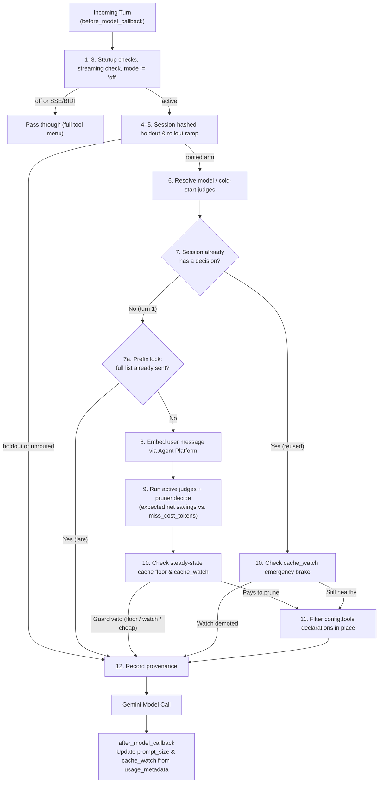
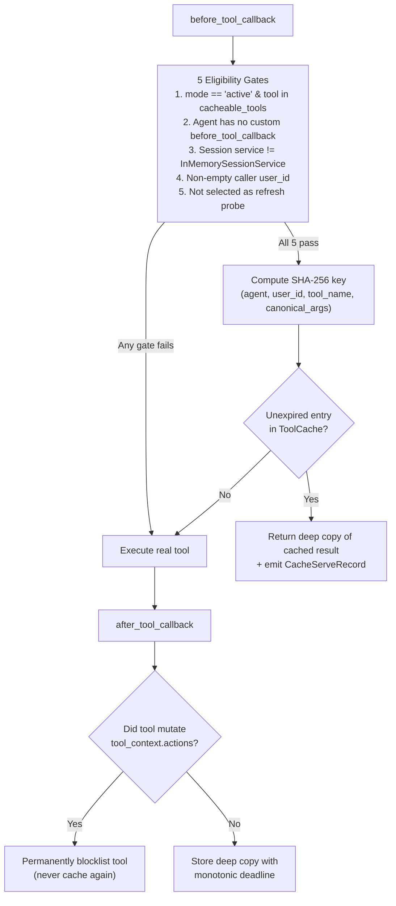

# Architecture

This page follows one request through the plugin, then describes each module and why it is a
separate file.

## The shape of the thing

The router is a single [ADK](https://adk.dev/) `BasePlugin`. Plugins install on the Runner, not on an agent, so one
plugin instance sees every agent in the App and resolves a model per agent name at request time.
There is no `agent_name` in the config for that reason.

It implements three callbacks:

| Callback | What it does |
| --- | --- |
| `before_model_callback` | Prunes the tool declarations, and edits nothing else. |
| `before_tool_callback` | Returns a memoized tool result, or nothing, and lets the call run. |
| `after_tool_callback` | Stores a result if the tool was declared cacheable and behaved. |

It writes no telemetry of its own. ADK's [BigQuery Agent Analytics
plugin](https://adk.dev/integrations/bigquery-agent-analytics/), BQAA below, already records every
turn to [BigQuery](https://cloud.google.com/bigquery), and that table is both the router's training
corpus and the ledger every measurement in these docs is read from. The router's only contribution
to it is a provenance record saying which model shaped which turn.

Every one of them is wrapped in `@fail_open`. That decorator is not defensive habit. ADK's
`PluginManager._run_callbacks` re-raises a plugin exception as a `RuntimeError` that aborts the
entire run, so an unhandled error anywhere in the router would turn a routing bug into a 500 on
the user's request. `None` means "no opinion" for every ADK plugin callback, so swallowing the
exception and returning `None` is always safe. A reflective test asserts that no callback was ever
added without the decorator.

## One turn, start to finish

`before_model_callback` runs a fixed sequence and returns `None` at the first step that says stop.
It always returns `None`, because returning a value would skip the model entirely.



**1. Startup checks.** Diagnostics about the App this plugin was installed into. They never affect
control flow, except for the agent authorization scan described below.

**2. Live and bidi streaming pass through.** Under `StreamingMode.SSE` or `BIDI` the request config
is shared by reference and preprocessed once, before the socket opens. A prune there is permanent
for the life of the connection and cannot be undone, so the router declines to touch it.

**3. The kill switch.** If `mode` is `"off"`, the router stops here. One flip disables pruning
and cache serves together.

**4. The holdout.** A fixed share of sessions is held out permanently, even at full rollout. The
holdout is the only unbiased corpus and the only valid A/B baseline, so it is not a rollout phase
that eventually ends. Held-out turns still emit a provenance record, because an analyst has to be
able to tell which turns were the control.

**5. The rollout ramp.** `route_fraction` decides whether this session is routed. The ramp and the
holdout hash the same three identifiers under different salts, so they are statistically
independent.

Both splits hash the session, never the turn. Under session-stable pruning a turn-hashed split is
contaminated: the decision is frozen for the whole conversation, so about half the "control" turns
would carry the treatment.

**6. Model resolution.** When `"xgboost"` is in `judges`, the plugin loads at most one artifact per
agent name, caching the negative result too, since a missing artifact fails identically every turn.
Age is rechecked on every use rather than at load, so a long-lived process demotes itself when its
artifact goes stale rather than serving a two-month-old model forever. If no artifact exists or the
loaded artifact ages out and a cold-start judge (`"prototype"`, `"llm_live"`, or a custom
`ToolJudge`) is configured in `judges`, the plugin falls back to the cold-start judge instead of
disabling routing.

**7. Recall.** If this session already made a decision, go straight to step 10 with it. No embed,
no predict, and no floor guard: that answer came with the decision. This is the entire point of
session stability. Decide once, then stop paying, in latency and in broken prefix caches both. The
watch in step 10 does still run, because an agent that is losing money has to be able to stop.

**7a. The prefix lock.** If this session has no decision but has already sent a full tool list, stop
here and record `late`. The first model call is the only free moment to choose a declaration list,
because nothing is cached yet and every list costs the same; after it, a different list is a new
prefix at full price. This runs before the embedding call, so a session that can no longer apply a
decision stops paying to make one. See *The moment the decision is free* below.

**8. Embed.** The latest user text goes to `gemini-embedding-2` through [Gemini Enterprise Agent
Platform](https://docs.cloud.google.com/gemini-enterprise-agent-platform/vertex-ai-name-changes),
the platform formerly called Vertex AI. On timeout,
open circuit breaker, malformed response or wrong dimensionality, the embedder returns `None` and
the session is pinned to passthrough for good. A per-turn retry would produce mid-session cache
breaks, which cost more than the routing saves.

**9. Predict and decide.** The active judges (`predictor.Predictor` for `"xgboost"` and any
configured `ToolJudge` instances in `judges.py`, such as `PrototypeJudge` or `LiveLlmJudge`) rank
tool names against the shared prompt embedding vector, and `judges.combine_predictions` merges them.
`pruner.decide` turns that ranking, the live tool set, the effective known classes, the prior
decision, the artifact's menus and the config into a `SessionDecision`. The pruner is pure: no I/O,
no logging, no clock, no randomness, no ADK import. That is what makes the rule provable in unit
tests rather than argued about.

**10. Ask whether applying it pays.** A decision to keep a set is not the same as a decision to
apply it. `pruner.breaks_cache` asks whether shrinking the prompt would carry a cacheable one
under the model's context-cache floor, measured against the size this agent's prompts settle at
rather than the turn in front of the plugin (`steady_state.PromptSizes`). That question is asked
once, when the decision is made, and its answer is carried on the decision. `cache_watch.CacheWatch`
asks whether pruning has already been shown to cost this agent money; that one is asked every turn,
because it is the emergency brake. Either says no and the turn passes through with the decision
intact. See *The cache guard* below.

**11. Apply.** `request_edits.apply_prune` filters `config.tools[].function_declarations` in place.
That is the whole edit. `contents` and `system_instruction` come out as they arrived.

**12. Record.** One provenance record per decision, including the decisions not to route.

Then, when the response comes back, `after_model_callback` reads `usage_metadata` off it and feeds
both numbers back: `prompt_token_count` calibrates the size estimate, `cached_content_token_count`
feeds the watch. It never returns a value, because a returned response would replace the model's.

## The moment the decision is free

The router's opinion is cheap and its commitment is not. Tool declarations sit inside the prefix
Gemini caches, so the first model call of a session is the only point at which choosing a list costs
nothing: no cache exists yet, and every possible list is equally priced. From the second call on,
the session is caching against whatever the first one sent, and a different list is not a smaller
prompt. It is a new prefix at full price.

That makes "the classifier was unsure, ask again next turn" the most expensive thing the router can
do. It sounds free, because no decision was written. Measured across 245 live routed sessions:

| | turn 2 cached | turn 2 billed |
| --- | --- | --- |
| pruned from turn one | 99.0% | 301 |
| full list turn one, pruned turn two | 6.7% | 2579 |
| holdout, never pruned | 99.3% | 392 |

Pruning from turn one beats the control by 23%. Pruning from turn two costs 6.6 times as much, to
send a smaller prompt. In that run 97 of 245 routed sessions took the second path, and on its own
that turned the whole experiment into a 17.6% loss.

So `prefix_lock.py` records which sessions have already sent a full tool list, and the router
refuses to prune those. It is one-way and per session, recorded as `decision_source = late`.

The cost is coverage, stated plainly: a session the classifier is unsure about on its first message
is now passthrough for good. That caps the routed arm at how often the first message is predictable,
which on the live corpus is 148 sessions in 512. It is the right trade at these numbers, because the
sessions given up were the ones losing 37.3%, but it moves the ceiling on this mechanism from a
caching problem to a modelling one.

## The cache guard

Gemini bills a [cached input
token](https://docs.cloud.google.com/gemini-enterprise-agent-platform/models/context-cache/context-cache-overview)
at about a tenth of an uncached one. So the router is not really
choosing between a big prompt and a small one; it is choosing which side of the context-cache floor
the prompt lands on. Below the floor nothing is cached and every token is full price. Above it,
almost everything is a tenth. A prune that crosses the line downward removes some tokens and makes
every remaining one ten times more expensive, which is a loss even when the prompt gets
dramatically shorter.

This is measured, not theorised. A router without the guard cuts the prompt on the reference agent
by 35 percent and raises the bill by 25, because the pruned arm spends whole conversations under
the floor while the unrouted arm grows past it by the second turn.

Two things follow, and both are in the code.

**The quantity is the whole prompt, not the tool menu.** Context caching covers the system
instruction, the declarations and the conversation history together, and the history grows every
turn. `prompt_size.py` counts what is actually on the request. It uses two ratios rather than one,
because tool declarations are JSON schema and tokenize about twice as densely as conversation, and
a prune is exactly the operation that changes which of the two dominates. The conversation ratio
recalibrates itself from every response; the schema ratio is a property of how BPE handles JSON and
is left fixed.

**Published cache floors are not obeyed, so the guard also has to watch.** A probe against
`gemini-2.5-flash`, documented minimum 2048: a 1919-token request cached 1778 tokens and a padded
2119-token request cached nothing, twice. Implicit caching is best effort. `cache_watch.py`
therefore compares what pruned and unpruned requests were actually billed, per agent, and stops
pruning an agent where pruning is losing. The permanent holdout supplies the unpruned arm for free.

The comparison excludes every session's first model call, on both sides. That call has no prefix of
its own to hit and bills about three times a continuation, and the router puts a different fraction
of them in each arm, because a declined session is passthrough for life while a routed one prunes
from turn one. Pooling them in made the statistic report the arms' turn mix instead of their cost,
and it was wrong on every run in the warehouse it had an opinion about. The price of the fix is
that the guard can no longer see a loss confined to turn one. That question is economic rather than
operational, and `predict_saving.py` answers it offline with the whole history in view.

The comparison is in billed-equivalent tokens rather than cache hit rate:

```
billed = (prompt_tokens - cached_tokens) + cached_tokens * 0.10
```

Hit rate looks like the natural quantity and is the wrong one. One run removed 28% of the prompt,
gave up 13.1 points of hit rate, and cost 7.5% more overall. A 20-point hit-rate margin stays quiet
through all of that, correctly by its own rule. The formula above sees the loss directly, so the
margin is 0.05 in the same units the router is judged in.

The two guards are ordered by how much they know. The floor guard is a prior that works from the
first request. The watch is evidence, and it wins as soon as it has any.

**A guard that changes its mind is a guard that costs money.** The floor condition is only true
inside a band: pruned below the floor, full above it. A conversation grows through that band, so a
floor guard asked on every turn prunes on turn one, stops on turn two and starts again on turn
four. The kept set never moves, but the declared list does, and that is what the cache is keyed
on. So the floor question is asked once, when the decision is made, and asked against
`steady_state.PromptSizes` — a running mean of this agent's prompt sizes — rather than against a
first turn, which is the shortest a session will ever be. The watch keeps its per-turn vote because
within a session it is one-way: it can only stop a session pruning, never restart it, and when it
does the turn is recorded with `cache_break` set. Re-promotion is a per-agent decision and reaches
new sessions only, for the same reason — a running conversation that swapped its prefix for a
smaller one would pay 6.6x for the privilege.

**The watch ignores every session's first model call.** Its two arms have to differ by the prune
and nothing else, and pooled over every call they do not. A session's first model call has no
prefix of its own to hit and bills about three times a continuation. The router's rule decides both
which arm a session lands in and how long it stays there, so the arms hold structurally different
fractions of first calls: 29.6% unpruned against 14.2% pruned on the run where this was caught.
That gap alone made pruning look 2.4% cheaper pooled while it was 25.9% worse on first calls and
18.4% worse on later ones. Waiting for menus to warm before counting a pruned call does not fix
this. It addresses a real effect on the wrong side of the comparison, and gets the answer backwards
on every run in the warehouse it has an opinion about.

`session_calls.py` holds a bounded LRU of scopes that have made a call, and the watch drops the
first call of each session from both arms. The exclusion costs about 21% of an agent's calls,
symmetrically, and `min_samples` is 50 rather than 25 to keep the remainder from firing early.

The gate delays a verdict, it does not remove one. The one shape that would lose its verdict
entirely is an agent whose sessions are a single model call each, and those calls are compared to
each other instead of dropped. Turn one against turn one has no mix to be confounded by, so the comparison is
sound; what it is not is cheap, because a turn-one price depends on prefixes other sessions left
warm. So the fallback asks for ten times the samples and three times the margin, and it is only
consulted while the main comparison is short. That ratio is also the gate: reaching 500 first calls
in both arms before either later-call arm reaches 50 takes traffic that is more than nine tenths
single-call sessions. `CacheWatch.coverage` returns both totals and `verdict_basis` says which
comparison spoke, and the demotion warning prints them.

The guard also gives up seeing a loss confined to turn one, and that is deliberate. Two runs in the
warehouse lost turn one and won from turn two onward, and pruning was the right call on both, so a
rule that could see turn one would have demoted them wrongly. A one-way per-process guard cannot
tell "these menus are young" from "this agent should never prune". That question is economic, and
`predict_saving.py` answers it offline with the whole history in view.

Demotion is reversible and bounded. After `cache_watch_cooloff_calls` counted calls the agent is
re-promoted and both arms are wiped, so it is re-judged on fresh evidence; the cool-off doubles each
cycle and after `cache_watch_max_repromotions` the demotion is permanent. Exposure per retry is
about 9% of the agent's calls and halves each cycle. The hard cap is what makes it terminate: a
growing multiplier on its own just makes an agent flap slowly forever.

The two cache guards are recorded apart in the warehouse, as `floor` and `watch`. A shared label
would make one demotion read as hundreds of sessions tripping a cache floor none of them came near.

The guard counts in memory, which makes it fast and makes it local. A replica sees only its own
traffic, so an agent whose sessions are spread thin across many processes never reaches a verdict
anywhere, and a restart forgets what was counted. The same question is therefore also asked offline
over every replica at once, by `scripts/fleet_cache_watch.py` and by the publish gate that calls
it. The comparison is `cache_watch.costs_more` in both places, one function rather than two
copies, and each replica's decisions carry the `replica_id` that lets the offline version compare a
replica against itself before averaging. `docs/operations.md` has the operator's view.

## Menus, and why the kept set is not bespoke

Pruning a bespoke set per session mints a new prefix almost every time. A live A/B run without
menus shipped 40 distinct tool menus across 65 sessions: each pruned prefix was seen a handful of
times and was usually cold at the start of a session, while the control arm sent one prefix that
was permanently hot. Pruning did not break the cache, it divided one hot prefix into forty tepid
ones.

The obvious repair is to hold part of the declaration list fixed and let the router choose only
the tail. A probe kills it: changing two declarations at the end of the list invalidates the
whole cached prefix, including the unchanged 1777-token system instruction ahead of them. For
implicit caching the declared tool list is part of the cache key, and there is no partial credit.

So a menu is whole or nothing. `menus.py` chooses M fixed menus from the training corpus, the
publisher writes them into the model artifact, and `pruner.decide` picks one by summing the
classifier's probability mass over each menu's tools. Three properties matter:

- **Deterministic.** Ties are settled by the sorted tool names, so two replicas given the same
  probabilities pick the same menu and two publishing machines given the same corpus emit the same
  artifact. Without that the mechanism reintroduces the fragmentation it exists to remove.
- **Growth moves between menus, never edits one.** When a session's first tool call is for
  something the current menu lacks, the router switches to a menu that holds it. If no menu does,
  it widens to the full set rather than mint a new prefix.
- **Optional.** An artifact with no `menus` field routes exactly as before, per session. Menus are
  a field, not a format change.

The cost is coverage, because a shared menu is by definition not the best seven tools for this
user. Measured on the corpus with oracle assignment, 8 menus cover 0.9878 of tool calls and 12
cover 0.9949, against 1.0 for bespoke and 0.8938 for a single static top-7.

## Why the prune leaves `tools_dict` alone

`apply_prune` edits `config.tools` and deliberately does not touch `llm_request.tools_dict`.
`tools_dict` is what ADK uses to actually execute a call. Filtering it would turn a stray call to a
pruned tool into an exception inside `_get_tool`, and BQAA would write a `TOOL_ERROR` row blaming
the tool. The router's own mistakes would then appear as tool failures in exactly the telemetry
used to detect over-pruning. Left intact, the same event is a silent and correct recovery.

## Why the router writes nothing into the prompt

The obvious way to tell a model its menu has been narrowed is a one-line directive on the deciding
turn. `LlmRequest._insert_transient_user_content` is the one steering hook in ADK that leaves
`system_instruction` alone, and it looks free, because the directive sits past the end of the
cacheable prefix.

It is not free. ADK inserts transient content *ahead* of the live user message, so the deciding
turn's `contents` differ from every later turn's from the third element on, and no later turn in
that session can cache against it. A twenty-exchange probe puts turn-two caching at 13 of 20 calls
without the directive and 7 of 20 with it, and moving it behind the user message makes it worse
rather than better. So the router says nothing and lets the shorter menu speak for itself.

The general rule this leaves behind: per-turn content is only free if it is on *every* turn.
Content that appears on some turns and not others is a fork in the prefix, not something outside
it.

## The tool result cache

Two modules split this job, because the two halves fail differently. Getting the key wrong corrupts
or leaks data. Getting the eligibility wrong leaks data or silently drops a side effect.



`tool_cache.py` owns the key, the clock and the bytes:

- `user_id` is inside the sha256, always. Most real tools are principal-scoped and take arguments
  that never mention the principal, so a key without identity serves one person's data to another.
  Identity is in the hash, never a filter applied after the lookup.
- Deep copy on write and on read. ADK hands the returned dict by reference to every downstream
  `after_tool_callback`, so one consumer mutating it in place would corrupt the stored entry and
  the corruption would compound on every subsequent hit.
- `time.monotonic()`, never wall clock. An NTP step backward makes entries immortal; a step forward
  mass-expires the cache into a thundering herd.
- An absolute deadline anchored to the first write, so an entry rewritten on every read cannot
  become immortal.

`cache_hooks.py` owns eligibility. Five conditions gate a serve and all five must pass: the router
is on and the tool was declared cacheable with a usable TTL; the agent does not gate its own tools;
the session service is not `InMemorySessionService`; the caller has a non-empty `user_id`; and this
call did not draw the refresh probe.

Storing has one rule serving does not. A tool that wrote to `tool_context.actions` is blocklisted
on the spot. Declaring a tool cacheable is a human assertion, and this is the mechanical check on
it. The check diffs the actions object against its own defaults using `model_dump`, rather than
against a hand-written field list, so a field added by a future ADK release cannot open a silent
side channel.

## Model artifacts

`model_store.py` is a supply-chain boundary, not a download helper. Whatever it returns is loaded
into every serving process, so the order of its checks is the substance:

1. `environment` first, because a cross-environment path collision means staging serves production.
2. Size before any bytes are pulled.
3. The sha256 digest before the file is handed to xgboost.

There is no `latest.json` pointer. A version directory counts only once both `metadata.json` and
`model.ubj` are present, so atomicity comes from completeness rather than from write ordering.
This is the only module allowed to import `google.cloud.storage`, and it imports it lazily so that
importing the package does not require the [Cloud Storage](https://cloud.google.com/storage)
library.

`model.ubj` rather than the `model.bst` that `EXPORT MODEL` writes. BigQuery exports XGBoost's
pre-1.0 binary format, and XGBoost removed the ability to read it in 2.1. `publish_router.py`
converts the file before publishing it, so neither of the two files the loader looks for exists in
a raw export directory. See [Training and publishing](training.md).

## Train and serve parity

The embedding is computed twice in this system: once by BigQuery
[`AI.EMBED`](https://docs.cloud.google.com/bigquery/docs/reference/standard-sql/bigqueryml-syntax-ai-embed)
during training, once
by `google-genai` at serving time. If those two produce different vectors, the model passes every
offline gate and predicts garbage in production, with no error anywhere.

Two things hold the contract together. The serving client is pinned to Agent Platform with
`vertexai=True`, because `google-genai` otherwise defaults to the Gemini Developer API, which gives the same model
name, the same dimensions, no error, and subtly different vectors. And the fields that both sides
read are marked "parity" in `config.py` and single-sourced: one field used on both sides, never one
field per side.

Feature naming is the same class of hazard. `EXPORT MODEL ... ML_XGBOOST_BOOSTER` renames features
by position, so the training SQL flattens the embedding to `f0..f767` and the predictor uses
positional names to match. Any semantic naming either errors out or, much worse, permutes the
inputs silently.

## Modules

| Module | Owns | Notes |
| --- | --- | --- |
| `plugin.py` | The ADK callbacks and their order | Wiring only. A policy decision written here is in the wrong file. |
| `config.py` | Every knob | Data only, no behaviour. |
| `rollout.py` | Holdout, ramp, scope key | Pure. Hashes the session, never the turn. |
| `embedding.py` | Prompt to vector | Pinned to Agent Platform. Timeout, LRU, circuit breaker. Never raises. |
| `model_store.py` | Fetch and verify the artifact | The supply-chain boundary. |
| `predictor.py` | Run the booster | Positional feature names. Never raises. |
| `judges.py` | Composable `ToolJudge` layer | `PrototypeJudge` schema-graph cold-start scorer, `LiveLlmJudge`, and multi-judge combiner. |
| `pruner.py` | What to keep | Pure, total, deterministic, zero I/O. |
| `menus.py` | Choosing menus, and picking one | Pure. Same corpus in, same menus out, on any machine. |
| `prompt_size.py` | How large a request is in billed tokens | Measures the request; calibrates itself from every response. |
| `cache_watch.py` | Whether pruning is billing more than not pruning | Per agent, in billed-equivalent tokens, excluding first calls. Re-promotes on a doubling cool-off, at most twice. |
| `steady_state.py` | The size an agent's prompts settle at | A running mean, so the floor guard asks about the session and not about its first turn. |
| `session_calls.py` | Which scopes have made a model call | A bounded LRU, so the watch can drop each session's first call from both arms. |
| `prefix_lock.py` | Which sessions have already sent a tool list | A bounded set of scopes. One-way: a session that sent the full list never prunes. |
| `request_edits.py` | Read and write an `LlmRequest` | The only module that touches one. |
| `cache_hooks.py` | Cache eligibility | Five gates to serve, six to store. |
| `tool_cache.py` | Cache key, clock, bytes | The security surface. |
| `startup_checks.py` | What the App looks like | Three diagnostics and one control. |
| `provenance.py` | Which model shaped which turn | Total. Never carries argument values. |

## Provenance

Rolling deploys run several model versions at once, so "which model was active then" is not
recoverable after the fact and has to be stamped on the turn. Every routing decision and every
cache serve writes its own record under the `smart_router` key.

Getting a record out of the process takes two hops. ADK keeps one `custom_metadata` bag on the
invocation and another on each event, and copies nothing between them. A callback can only reach
the invocation's, and BQAA reads the event's. So the callbacks emit into the invocation bag, and
`on_event_callback` moves whatever has accumulated there onto the event just before ADK persists
it. Moves, not copies: a turn with a tool call produces several events, and a record duplicated
across them would inflate every rate computed from `agent_events`.

`CacheServeRecord` never carries the args hash or any argument value. Arguments contain PII, and a
hash over a low-cardinality argument space is reversible. The same reasoning governs the cache
hit marker, which is a bare boolean rather than the key it came from, and which lives on the
call's `ToolContext` rather than in session state. The router writes no session state at all.

## Startup checks

Three of the four are log lines aimed at whoever wired up the App, and all three catch silent
misconfigurations, which are the worst kind, because the router keeps running and looks fine.

Plugin order is the first. If an analytics plugin is registered before the router, every cache hit
is logged as a real tool call with `total_ms=0`, measured TTLs inflate without bound, and the next
model trains on the router's own echo.

Context cache config is the second. Without one the prefix is never cached, so session-stable
pruning saves the declaration tokens and none of the cache-hit discount the design was built
around.

Judge wiring is the third. When `"xgboost"` is in `judges`, `StartupChecks` verifies once per
process that `xgboost` and `google.cloud.storage` are importable (`importlib.util.find_spec`) and,
when `mode == "active"` with `"xgboost"` as the only judge, that `gcs_bucket` is set — catching a
missing optional extra or unset bucket immediately instead of failing open silently on every turn.

The fourth does change behaviour. An agent that declares its own `before_tool_callback` is recorded,
and the tool result cache refuses that agent from then on, because a plugin-level cache hit
short-circuits before the agent's own callback chain runs, and that chain is where most ADK users
put authorization. The scan record is keyed by object address through a weak value map, so an app
that rebuilds its agent tree per request cannot inherit a stale verdict from a freed object that
happened to share an address.

## Further reading

- [docs/operations.md](operations.md) for rollout and what to watch.
- [docs/training.md](training.md) for the corpus and the BigQuery pipeline.
- [docs/threat-model.md](threat-model.md) for the security boundaries and operator checklist.
