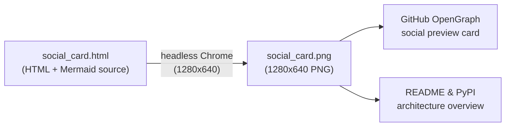

# `docs/assets/` — Static Documentation & Social Preview Assets

This directory holds static visual assets used by the GitHub repository social preview card, documentation, and the PyPI package description.



## Directory Map

| File | Responsibility |
| :--- | :--- |
| [`README.md`](./README.md) | Directory map and regeneration instructions for static visual assets. |
| [`social_card.html`](./social_card.html) | Self-contained 1280×640 HTML + Mermaid source for the repository social preview card using the four-class palette (`data`, `config`, `route`, `compute`). |
| [`social_card.png`](./social_card.png) | Rendered 1280×640 PNG used for GitHub repository social previews and static OpenGraph metadata. |

## Regenerating `social_card.png`

From the repository root:

```bash
google-chrome --headless=new --disable-gpu --hide-scrollbars \
  --window-size=1280,640 --virtual-time-budget=8000 \
  --screenshot=docs/assets/social_card.png \
  "file://$(pwd)/docs/assets/social_card.html"
```
