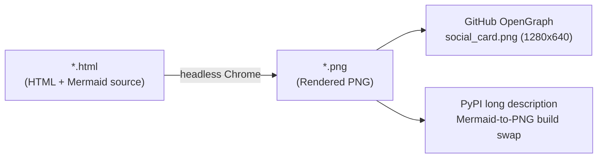

# `docs/assets/` — Static Documentation, Social Preview & PyPI Mermaid Fallback Assets

This directory holds static visual assets used by the GitHub repository social preview card, `README.md`, and the PyPI package description (`hatch-fancy-pypi-readme` swaps `README.md`'s ` ```mermaid ` blocks to these pre-rendered PNGs at build time because `pypi.org` does not execute Mermaid JS).



## Directory Map

| File | Responsibility |
| :--- | :--- |
| [`README.md`](./README.md) | Directory map and regeneration instructions for static visual assets. |
| [`social_card.html`](./social_card.html) / [`social_card.png`](./social_card.png) | 1280×640 repository social preview card using the four-class palette (`data`, `config`, `route`, `compute`). |
| [`readme_judge_tiers.html`](./readme_judge_tiers.html) / [`readme_judge_tiers.png`](./readme_judge_tiers.png) | 1060×410 PyPI fallback PNG for the `README.md` judge tiers diagram (`PrototypeJudge`, `XGBoost`, and Hybrid). |
| [`readme_turn_sequence.html`](./readme_turn_sequence.html) / [`readme_turn_sequence.png`](./readme_turn_sequence.png) | 1120×660 PyPI fallback PNG for the `README.md` per-turn `SmartRouterPlugin` + `BigQueryAgentAnalyticsPlugin` sequence diagram. |
| [`readme_training_loop.html`](./readme_training_loop.html) / [`readme_training_loop.png`](./readme_training_loop.png) | 600×440 PyPI fallback PNG for the `README.md` BigQuery ML training and GCS promotion flowchart. |

## Regenerating PNG Assets

From the repository root:

```bash
DIR="$(pwd)/docs/assets"
google-chrome --headless=new --disable-gpu --hide-scrollbars --window-size=1280,640 --virtual-time-budget=8000 --screenshot="$DIR/social_card.png" "file://$DIR/social_card.html"
google-chrome --headless=new --disable-gpu --hide-scrollbars --window-size=1060,410 --virtual-time-budget=8000 --screenshot="$DIR/readme_judge_tiers.png" "file://$DIR/readme_judge_tiers.html"
google-chrome --headless=new --disable-gpu --hide-scrollbars --window-size=1120,660 --virtual-time-budget=8000 --screenshot="$DIR/readme_turn_sequence.png" "file://$DIR/readme_turn_sequence.html"
google-chrome --headless=new --disable-gpu --hide-scrollbars --window-size=600,440 --virtual-time-budget=8000 --screenshot="$DIR/readme_training_loop.png" "file://$DIR/readme_training_loop.html"
```
