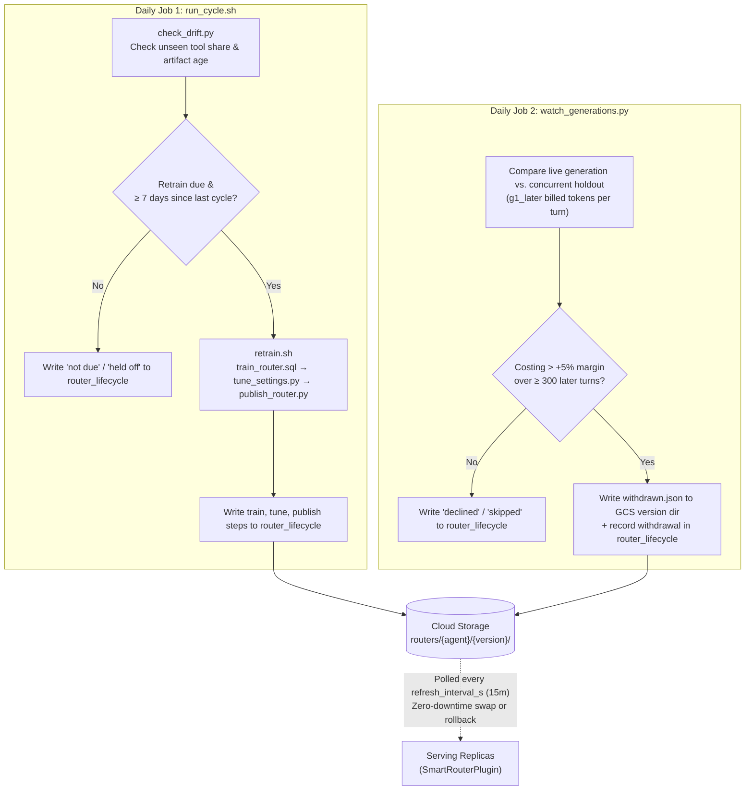

# Operations

How to turn the router on, how to turn it off in a hurry, and what to look at while it runs.

For provisioning and teardown of the cloud resources, see [`scripts/README.md`](../scripts/README.md).
It documents every resource, every environment variable, what each script costs, and exactly what
teardown does and does not remove.

## Turning it on

The router ships disabled. `mode` is `"off"` and `route_fraction` is `0.0`, so installing the
plugin changes nothing. Enabling it takes two variables:

```bash
export SMART_ROUTER_MODE=active
export SMART_ROUTER_ROUTE_FRACTION=0.01
```

Only the operational knobs are exposed as environment variables, and that is on purpose: an
operator has to be able to flip the router off or pin a version without a code change.

| Variable | Maps to |
| --- | --- |
| `SMART_ROUTER_MODE` | `mode`, `off` or `active` |
| `SMART_ROUTER_ROUTE_FRACTION` | `route_fraction` |
| `SMART_ROUTER_HOLDOUT_FRACTION` | `holdout_fraction` |
| `SMART_ROUTER_PIN_VERSION` | `pin_version` |
| `SMART_ROUTER_GCS_BUCKET` | `gcs_bucket` |
| `SMART_ROUTER_BQ_PROJECT` | `bq_project` |
| `SMART_ROUTER_BQ_DATASET` | `bq_dataset` |
| `SMART_ROUTER_BQ_CONNECTION` | `bq_connection` |
| `SMART_ROUTER_VERTEX_LOCATION` | `vertex_location` |
| `SMART_ROUTER_ENVIRONMENT` | `environment` |
| `SMART_ROUTER_LOCAL_CACHE_DIR` | `local_cache_dir` |
| `SMART_ROUTER_REFRESH_INTERVAL_S` | `refresh_interval_s` |
| `SMART_ROUTER_JUDGES` | `judges`, comma-separated (`xgboost`, `prototype`, `llm_live`) |
| `SMART_ROUTER_PROTOTYPE_WEIGHT` | `prototype_weight` |
| `SMART_ROUTER_COLD_START_MENU_COUNT` | `cold_start_menu_count` (`0` = bespoke subsets; `> 0` = synthesize fixed catalog menus) |

Anything unset or unparseable falls back to the dataclass default rather than raising. A
malformed config value must not take down serving.

`SMART_ROUTER_VERTEX_LOCATION` keeps its name because the field does. It is the region the
embedding endpoint is called in, on what is now [Gemini
Enterprise](https://docs.cloud.google.com/gemini-enterprise-agent-platform/vertex-ai-name-changes).

## Warming up at startup

Call `await plugin.warmup()` once, after building the Runner and before serving any traffic.

The first embedding call a process makes costs about 1.9 seconds. Steady state is 170 ms, and
`embed_timeout_ms` is 600 ms, so a cold process times out on its first prompt. Because a routing
decision is session-stable and one embedding failure pins the session to passthrough, that single
timeout costs the whole session rather than the one turn.

```python
runner = InMemoryRunner(app=app)
await plugin.warmup()
```

It is optional and it is not automatic. There is no event loop when the plugin is constructed, and
a background task fired from the first callback would have to outlive the request that started it.
Skipping it degrades one session per process start; it does not break anything. `warmup()` returns
whether the endpoint answered, uses its own budget (`embed_warmup_timeout_ms`, 10 s) rather than
the hot-path one, and a failure does not count toward the circuit breaker.

## Rolling out

The suggested ramp, with a soak at each step long enough to see a full traffic cycle:

| Step | `route_fraction` | What you are checking |
| --- | --- | --- |
| 1 | `0.01` | Nothing broke. `failopen_counts` is empty. Provenance rows appear. |
| 2 | `0.05` | Coverage in the routed arm matches the backtest. |
| 3 | `0.25` | Token spend per session is falling against the holdout. |
| 4 | `1.0` | Steady state. The holdout stays at 5 percent forever. |

The holdout is not a rollout phase. It is a permanent control arm, held out even at
`route_fraction = 1.0`, because it is the only unbiased corpus and the only valid A/B baseline.
Turning it off means every subsequent claim about the router's value is made against data the
router shaped.

The holdout and the ramp hash the same three identifiers under different salts, so a session's
holdout membership is independent of its ramp membership. Increasing `route_fraction` never moves
a session out of the holdout.

## Measuring it

Everything measured here is read out of the table ADK's BigQuery Agent Analytics plugin, BQAA
below, is already writing to [BigQuery](https://cloud.google.com/bigquery). Its documentation is
in two places: the [ADK integration
guide](https://adk.dev/integrations/bigquery-agent-analytics/) and the [BigQuery
documentation](https://docs.cloud.google.com/bigquery/docs/bigquery-agent-analytics). The router adds one provenance record per decision
and reads nothing back at request time.

The holdout only pays for itself if somebody reads it. Two scripts do that:

```bash
uv run python scripts/run_ab.py --confirm          # drive traffic through both arms
uv run python scripts/report_ab.py --prefix ab-20260901-
```

`run_ab.py` is for a test agent; on a real deployment your production traffic already fills both
arms and you only need the report. `report_ab.py` labels each session from the router's own
provenance, joins to `v_llm_response`, and prints the gate.

The number it prints is G1: **billed-equivalent input tokens per turn, routed against holdout.**
Billed-equivalent means `uncached + 0.10 x cached`, not raw prompt tokens. That distinction is the
whole measurement. Gemini bills a [cached input
token](https://docs.cloud.google.com/gemini-enterprise-agent-platform/models/context-cache/context-cache-overview)
at about a tenth of an uncached one, so a router that cuts the prompt but breaks the cache looks
like a win on prompt tokens and is a loss on the invoice.

That is not hypothetical. Without the guards described below, the reference agent does exactly
that: the raw prompt falls 35 percent and the bill rises 25 percent, because pruning keeps the
prompt under the model's 2048-token cache floor for the whole conversation while the unrouted arm
grows past it by turn two.

**Read the `cached` column in the arms table before you read the G1 line.** If the routed arm's
cached share is well below the holdout's, pruning is turning caching off, and the G1 number below
it is measuring a cache break rather than a saving. The guards described in the next section are
built to prevent that, and this is how you check they did.

The target is −10 percent. Do not set it against a raw-prompt figure: −35 on raw prompt tokens is
the same run that billed +25. On an agent shaped like the reference one, −13 is about the ceiling,
because the router can only prune while the prompt is still under the floor.

## The cache guards

Pruning saves money only when it does not cost the session its cached prefix. Three guards protect
that, and all three are on by default.

The **prefix lock** refuses to prune a session that has already sent a full tool list. Tool
declarations sit inside the cached prefix, so the first model call of a session is the only free
moment to choose a list: nothing is cached yet and every list is priced the same. After it, a
smaller list is not a smaller prompt, it is a new prefix at full price. A refusal shows up as
`decision_source = late`.

This is why the router never says "the classifier was unsure, ask again next turn". That sounds
free and is the most expensive thing it can do. Measured on 245 live routed sessions, turn two
cached 99.0 percent and billed 301 tokens when the session pruned from turn one, against 6.7
percent and 2579 tokens when it sent the full list first and pruned second. The holdout billed 392.
Pruning on time beats not pruning by 23 percent; pruning one turn late costs 6.6 times as much to
send a smaller prompt.

The lock is checked before the embedding call, so a session that can no longer apply a decision
stops paying to make one. It costs coverage, and that cost is real: a session the classifier is
unsure about on its first message is passthrough for good, which caps the routed arm at how often
first messages are predictable. On the reference corpus that was 148 sessions in 512. A high `late`
rate is a signal about the classifier, not about the lock.

The **floor guard** refuses a prune that would carry a cacheable prompt under the model's floor.
It is asked once, on the turn the routing decision is made, and its answer is held for the rest
of the session. A refusal shows up as `decision_source = floor` and the session sends the full
tool list from then on.

Asking it every turn is what a first reading of the rule suggests, and it is wrong. The condition
it tests is only true inside a band, pruned below the floor and full above it, and a growing
conversation passes through that band. A per-turn guard therefore prunes on turn one, stops on turn
two and starts again on turn four. The declared tool list moves each time, which is the one thing
that costs a session its cached prefix.

Because it is answered once, it is answered against the size this agent's prompts usually
reach rather than the size of the turn in front of it. A first turn is the shortest a session
will ever be. The estimate is a running mean of `prompt_token_count` over the turns this process
has seen for that agent, and until there are `steady_state_min_samples` of them the guard
measures the live request instead.

The **cache watch** compares what the two arms were actually billed. It groups responses by
whether the router pruned them, reads `prompt_token_count` and `cached_content_token_count` off
each one, and charges the cached tokens at a tenth. When an agent's pruned calls bill more per
call than its unpruned ones, over enough of both to mean something, pruning switches off for that
agent and stays off until the process restarts. A demotion shows up as `decision_source = watch`.
It logs one warning naming the agent and the numbers behind the verdict:

```
smart_router: pruning is costing support more than it saves (662 billed tokens
per call over 31 warm pruned calls, against 616 over 26 unpruned; cache hit rate
61% against 93%; 84 further pruned calls ignored while their menus were still
warming); pruning is now off for this agent until redeploy
```

That warning is worth alerting on. It does not mean anything is broken, the guard is doing its
job, but it means this agent is not a candidate for tool-menu pruning and you should stop paying
for the embedding calls.

The hit rates are printed for diagnosis only. The verdict is the billed figure, because a prune
can lose hit rate and still win, or hold hit rate and still lose.

**The watch ignores every session's first model call.** Both of its arms have to differ by the
prune and nothing else, and pooled over all calls they do not. A first call has no prefix of its
own to hit and bills about three times a continuation, and the router decides which arm a session
lands in with a rule that also decides how long the session stays there, so the two arms hold
structurally different fractions of first calls. On the run this was measured, 29.6% of the
unpruned arm against 14.2% of the pruned one, which is enough to make pruning look 2.4% cheaper
while it was in fact worse in both strata.

The last figure in the warning is what the watch excluded: every session's first model call, on
both sides. That call has no prefix of its own to hit and bills about three times a continuation,
and the router's own rules mean the two arms hold different fractions of them, so pooling them in
measured the arm's turn mix rather than its cost. Excluding them costs about 21% of an agent's
calls. If the excluded figure dwarfs the counted one, this agent's sessions are mostly one call
long and the guard has nothing to compare; it will never reach a verdict, and that is reported
rather than guessed at.

Demotion is not permanent. After `cache_watch_cooloff_calls` counted calls the agent is re-promoted
and both arms are wiped, so it is re-judged on fresh evidence rather than re-firing on stale
counters. The cool-off doubles each cycle and after `cache_watch_max_repromotions` the demotion
sticks for the life of the process. Sessions already running when a re-promotion lands are not
affected: a session that has sent the full tool list stays on it, because swapping its prefix would
cost more than the smaller prompt saves.

| Knob | Default | What it does |
| --- | --- | --- |
| `cache_watch_enabled` | `True` | Turn the watch off to measure the floor guard on its own. |
| `cache_watch_min_samples` | `50` | Calls needed **in each arm** before a verdict is possible. |
| `cache_watch_margin` | `0.05` | How much more the pruned arm may bill per call before it is demoted. |
| `cache_watch_cooloff_calls` | `500` | Counted calls a demoted agent waits before it is re-promoted and re-judged. Doubles each cycle. |
| `cache_watch_max_repromotions` | `2` | After this many re-promotions the demotion is permanent for the process. |
| `cache_watch_first_call_min_samples` | `500` | Session-opening calls needed **in each arm** before the fallback comparison may speak. Only reachable on an agent whose sessions are one call long. |
| `cache_watch_first_call_margin` | `0.15` | The wider margin that fallback demotes on, because a turn-one price depends on prefixes other sessions left warm. |
| `cached_token_multiplier` | `0.10` | What a cached input token costs against an uncached one. Agent Platform's ratio. |
| `steady_state_min_samples` | `25` | Turns an agent must contribute before the floor guard uses its typical prompt size instead of the live request. |

The unpruned arm comes free from the holdout and from sessions the router declined, which is the
second reason to keep `holdout_fraction` above zero permanently. Set it to zero and the watch can
never reach a verdict.

### Two limits worth knowing before you rely on it

The fallback comparison has never spoken. Its floor of 500 session openings in each arm is
deliberately high, because reaching it before either later-call arm reaches 50 takes a traffic mix
that is more than nine tenths single-call sessions, and that ratio is the gate rather than an
accident. But the largest routed opener count anywhere in this project's logs is 285, so no run has
ever come close, and the path is untested against real traffic rather than merely unused. If your
agent's sessions really are one call long, expect to reach a verdict slowly or not at all, and read
the excluded-calls figure in the warning to tell which case you are in. Lowering the floor lowers
the gate with it, so it is a decision about what kind of agent this guard should judge and not a
number to tune down when it is quiet.

The counters live in process memory and start from nothing on every restart. A lightly routed agent
may therefore never reach a verdict however long the deployment runs, because each process
accumulates its own partial evidence and then throws it away. The measured case is `ab-20260902`,
which lost 13.8% with 15 warm routed calls against a floor of 50 and was never judged. The guard is
sound on an agent with steady traffic in one process and blind on an agent whose traffic is spread
thin across many.

That is the blind spot the fleet-wide check below covers.

## Asking the same question of the whole fleet

Every input the in-process watch consumes is already in the warehouse, written from every replica:
the prompt size and cached share on `v_llm_response`, the arm and the deciding process on the
provenance record. So the comparison can be run offline over all of them at once, which is what
`scripts/fleet_cache_watch.py` does.

```
uv run python scripts/fleet_cache_watch.py --agent support --days 30
```

It prints one row per replica, then two summary numbers: the pooled comparison, and a standardised
one that compares each replica against itself before averaging. The standardised number is the one
to act on. Replicas hold different mixes of routed and holdout sessions, and pooling across mixes
is how a comparison ends up saying pruning is free while every replica is losing money. When the
two disagree, the difference is the mix.

The rule and the thresholds are the shipped ones. It calls the same `costs_more` the live guard
calls, and `--min-samples` and `--margin` default to `cache_watch_min_samples` and
`cache_watch_margin`, so the two cannot quietly diverge. Like the live guard, it counts later calls
only and ignores every session's first model call.

The same measurement is gate criterion 4 in `publish_router.py`, which refuses to publish a new
artifact for an agent whose fleet is already paying more to prune than not to. A replay of the
holdout cannot see that, because a replay does not know about the implicit cache. If a replica has
too little of either arm to judge, or the agent has no holdout, the gate reports it as unmeasured
and publishes: unmeasured is not the same as failing. `--skip-fleet-gate` skips the read.

Two things it does not do. It does not switch anything off, so a demotion still has to come from
the live guard or from you; and it is a rolling window rather than a per-artifact cut, because
holdout decisions carry no model version to key on. If the window straddles a republish it says so.

## The kill switch

Set `SMART_ROUTER_MODE=off` and restart. One flip disables pruning and cache serves
together, and the agent reverts to declaring every tool.

For a process already running, call `set_mode` on the plugin instance:

```python
plugin.set_mode("off")
```

The config is frozen and shared, so both the plugin and its cache hooks are rebound together by
that one call. Use `set_mode`, not `plugin._cfg`: poking the field directly leaves the cache hooks
still serving from the old config, and the router keeps answering from memory after you thought you
had turned it off.

The mode is read once from the environment at process start, so the environment variable route
needs a restart. The artifact is re-polled and the mode is not, which is a deliberate asymmetry:
nothing can change an environment variable inside a running container, so re-reading it would find
the same answer every time. The durable remote switch is the artifact side, covered below.

## Rolling back a model

Artifacts live at `routers/{agent}/{version}/` in the bucket, with versioning on, so rollback is by
generation rather than by restore. Three ways to do it, and the first one is the one to reach for.

**Withdraw the generation.** A `withdrawn.json` in a version's directory makes the loader stop
counting that directory as published, so the version before it becomes the newest and every
running process falls back on its next re-poll. No redeploy and no restart, and nothing is
deleted.

```bash
uv run scripts/watch_generations.py --agent support
uv run scripts/watch_generations.py --agent support --restore 20260905T171738Z
```

Run without `--restore` it judges the current generation and withdraws it only if it is worse than
its own holdout arm; the next section is about that. `--restore` deletes the marker and puts the
version back, which is the whole undo.

**Pin.** Set `SMART_ROUTER_PIN_VERSION` to a known-good version and restart. A pin also switches
the re-poll off, and it overrides a withdrawal, because a pin is somebody saying which artifact
they want and that outranks an automatic judgement.

**Wait.** `max_model_age_days` defaults to 14, and age is rechecked on every use rather than at
load, so a process that has been up for weeks demotes itself to passthrough when its artifact goes
stale. That is a safety net, not a rollback plan.

## The generation watch

`watch_generations.py` is the rollback running by itself. It compares the generation that is
serving against its own concurrent holdout arm, on the same traffic at the same time, and
withdraws it if routing is costing more per turn than not routing at all. That is the contract
stated as arithmetic: at worst no improvement, never degradation.

```
$ uv run scripts/watch_generations.py --agent support

==> support, version 20260905T171738Z, live 61 hours
    routed      873.8 over 6157 later turns
    holdout    1242.6 over 6241 later turns
    g1_later  -29.7%   ·   g1 pooled -10.6%

    declined: routing costs -29.7% per later turn against its own holdout arm, inside the
    5% margin, over 6157 routed and 6241 holdout later turns.
```

Four things about it are worth knowing before you schedule it.

**It reads `g1_later`, not `g1`.** A session's first model call bills about three times a
continuation, and pruning pushes that one call the wrong way while making every later call much
cheaper. Judging on the pooled figure would make this a measurement of prefix behaviour rather than
of the model. [docs/dashboard.md](dashboard.md) has the numbers behind that.

**It needs traffic in both arms.** 300 priced later turns each by default, `--min-later-turns`.
Below that it writes `skipped` and changes nothing, because a percentage computed against a nearly
empty control arm is noise wearing a decimal point.

**It will withdraw at most once per agent per day.** `--max-withdrawals` and `--window-hours`.
Falling back is allowed to cascade, and running it to its end leaves the agent in passthrough,
which is the contract's floor reached the long way round. The rate limit is only there so that a
bad measurement cannot walk an agent back through several generations before anyone reads the
ledger. A held-back withdrawal still records what it would have done.

**It writes a row every time it looks.** `ok`, `declined` or `skipped`, on the `withdraw` step of
the ledger, carrying both arms and both thresholds. A watch that writes only when it acts is
indistinguishable from a watch that is not running.

`--dry-run` judges and prints without touching the bucket or the ledger.

## Picking up a new artifact

A running process re-reads the bucket every `refresh_interval_s`, 900 seconds by default, and
swaps in a newer version by itself. No redeploy, and no restart. Set the interval to `0` to switch
that off, or pin a version, which does the same thing.

The check is cheap and almost always stops early. It is one list of the agent's prefix, compared
against the version already loaded. Only a version that differs causes a download, a digest check
and a compatibility check, and only a router that comes through all three is swapped in. Anything
that fails leaves the process serving exactly what it was serving before, which is the property
that makes this safe to leave running.

Nothing waits on it. The turn that notices the interval has elapsed is served by the router already
loaded, and the refresh happens behind it. A session that has already decided keeps its decision,
so a swap never changes a declared tool list mid-conversation.

Two things this does not do. The mode is still read once at process start, so `SMART_ROUTER_MODE`
still needs a restart. And an artifact built against a different embedding model is refused rather
than adopted, because serving would then embed with one model and predict with a booster fit on
another. That refusal is correct and it means an embedding change is a coordinated upgrade, not
something the re-poll can deliver.

## When the artifact will not load

A process loads each agent's artifact once, on that agent's first turn. Two things bound what
happens when the load goes badly.

`model_load_timeout_s` defaults to 30 and is a stuck-connection bound, not a latency target. The
reference load takes about 2.2 seconds. If it overruns, the turn passes through and says so, and
the load is treated as failed.

`model_retry_after_s` defaults to 300, and it is how long a failed load is believed. After that
window the next turn tries again. Without that window a failure is permanent, and a minute of Cloud
Storage trouble during a rollout leaves the process passing everything through until it is
redeployed, with one WARNING line to show for it.

Recovery is visible on new sessions only. A session that was already in flight has sent a full tool
list, and pruning it now would buy a smaller prompt at the price of a new prefix, so the prefix lock
keeps it in passthrough for the rest of its life. Watch `decision_source` in BigQuery rather than
the log if you want to see the moment a process starts routing again.

This window is on failure only. It is what stops a cold process hammering the bucket for an
artifact that is not there, and it is separate from the re-poll above, which runs on a process that
already has a working model. A refresh that fails is not negative-cached at all, because nothing is
passing through while it fails and there is no damage to bound.

## What to watch

**`plugin.failopen_counts`** is a read-only mapping of callback name to the number of times that
callback swallowed an exception. In a healthy deployment it is empty. Anything nonzero means the
router is passing through and something upstream is broken, so alert on the first occurrence rather
than on a rate.

**`plugin.cache.stats`** carries `hits`, `misses`, `expired`, `stores`, `evictions`, `purges`,
`refused_size` and `blocked`. `blocked` is the count of tools caught writing to
`tool_context.actions` and permanently refused; if it is nonzero, a tool was declared cacheable
that should not have been, and the declaration should be removed rather than left to the
blocklist. A rising `evictions` means `cache_max_entries` is too small for the working set.

**`plugin.embedder_stats`** counts what the embedding client did: `calls`, `timeouts`, `errors`
and `skipped`, where `skipped` is calls the circuit breaker refused to make. Every failure costs a
whole session, not a turn, so read the failure rate against session count rather than turn count.
Repeated failures are re-reported every `embed_failure_log_every` losses rather than logged once,
so a breaker that opens and stays open is visible in the logs.

**Provenance records** are appended to `ctx.custom_metadata["smart_router"]` as they happen, and
moved onto the event under the same key just before ADK persists it. Both hops are needed: ADK
copies nothing from the invocation to the event, and BQAA reads the event. A record that cannot be
written at all falls back to a structured log line under the same key. Two record shapes share the
list with no discriminator field, so tell them apart by the presence of `tool_name`.

For the records to reach `agent_events`, add `smart_router` to BQAA's `custom_metadata_allowlist`.
Without it BQAA drops the key and the records stay in the local logs.

A routing record carries `decision_id`, `agent_name`, `session_id`, `mode`, `model_version`,
`model_digest`, `top_label`, `confidence`, `kept_tools`, `decision_source`, `cache_break` and
`replica_id`. The last is a random id minted once per process, and it exists so a cost comparison
across replicas can be made within a replica first; nothing else reads it. Note that
`model_version` and `model_digest` are NULL on a holdout record, because a holdout decision is
taken before any artifact is resolved. The `decision_source` values are the ones worth building a
dashboard on:

| Source | Meaning |
| --- | --- |
| `fresh` | A decision made this turn. |
| `reused` | The session's existing decision, re-applied. |
| `holdout` | Control arm. Recorded, never routed. |
| `cheap` | The decline rule said no: what this menu removes, over an expected session, is worth less than the chance of missing a tool it dropped. Full tool set sent. This is the ordinary way a session declines. |
| `lowconf` | No prediction came back at all. Full tool set sent. Rare, and worth looking into if it is not. |
| `small` | Fewer than `min_tools_to_route` tools. Not worth routing. |
| `late` | The session already sent a full tool list, so its prefix is set and pruning now would buy a smaller prompt at the price of a new one. Per session and permanent. Usually the tail of a `cheap` first turn. |
| `floor` | The floor guard withheld the prune at decide time and the session is holding that answer. The decision stands; applying it would have carried the prompt under the cache floor. |
| `watch` | `cache_watch` has stopped this agent. Unlike `floor` this is not per session: once it appears, every session on that agent sends the full tool list until the agent is re-promoted, or permanently if it has used up its re-promotions. One agent's demotion can account for a whole run of these. |
| `error` | Embedding failed with an exception. The session is pinned to passthrough. |
| `timeout` | The embedding call exceeded `embed_timeout_ms`. Pinned to passthrough. |
| `breaker` | The embedder's circuit breaker is open after repeated failures, so no call was made. Pinned to passthrough. |
| `noop` / `disabled` | Nothing to do, or the router is off. |

A healthy routed arm is mostly `reused` with one `fresh` per session. A high `cheap` rate means one
of two things, and they are told apart by looking at what the declined sessions had to gain. If the
menus were saving real tokens, the model is out of distribution for your traffic and should be
retrained before the ramp goes any further. If they were not, the agent's tool surface is too small
or too cheap for routing to pay, and `miss_cost_tokens` is the dial. Either way it drags `late` up
with it, since a session that declines on its first message can never be routed afterwards. A high `error` rate is an embedding endpoint problem, not a
router problem.

A cache serve record carries `decision_id`, `agent_name`, `session_id`, `tool_name`, `entry_age_s`,
`ttl_used`, `ttl_source` and `probe`. It never carries arguments or a hash of arguments, and
nothing should be added that does. Arguments contain PII and a hash over a low-cardinality
argument space is reversible.

## The operating loop

Everything above is a counter on a running process, which means it is gone when the process is.
The loop below is the part that outlives it.



**Every day, or whenever somebody asks.**

```bash
uv run smart-router status --agent support
```

One screen: what artifact is live, what the last seven days cost against the holdout arm, where
the decisions went, and whether a retrain is due. Read only, no model traffic, and it prints what
it scanned.

**On a schedule, daily is reasonable.**

```bash
./scripts/run_cycle.sh --confirm --agent support
```

One command for the whole loop. It asks `check_drift.py` whether a retrain is due, stops there
when it is not, and runs `retrain.sh` when it is, under the same cycle id so the verdict and the
retrain it caused are one row in `v_router_cycles`. Serving processes pick the new artifact up on
their own within `refresh_interval_s`, so there is nothing to redeploy.

Running it daily does not mean retraining daily. A minimum of seven days between cycles is read
out of the ledger, not out of a file on the runner, so a container that will not exist tomorrow
reaches the same answer as a long-lived VM and two triggers in one day retrain once. Change it
with `--min-interval-days`, override it with `--force`.

Retraining on a spurious trigger is safe and always was. Gate 1 refuses to publish a model that
does not beat the incumbent, gates 2 through 4 refuse to train one that does not beat its own
baseline, and the tuner declining means "keep last cycle's answer". The worst outcome is a
training bill and a cycle that publishes nothing. The interval is there because that bill is real,
not because a cycle is risky.

Without `--confirm` it runs the check, evaluates the interval, prints the `retrain.sh` command it
would have run, and trains nothing. The two steps underneath are still usable on their own:
`check_drift.py --agent support` for a verdict without any consequence, and `retrain.sh --confirm`
to retrain whatever the check says.

**What makes a retrain due.** Three things, and only two of them gate.

| Signal | Gates | Why |
| --- | --- | --- |
| Unseen share above its own baseline | Yes | Tracks the harm. A surface change from 25 tools to 100 cost 36 points of recall and moved this signal 51 points at the same instant. |
| Artifact age | Yes | The fallback for everything the first one cannot see. |
| Top-1 confidence | No | Sensitive to change rather than to harm: an intent shift moved it 0.25 for 1.3 points of recall. Printed, never triggered on. |

**Where the history lives.** Every step of every cycle writes a row into `router_lifecycle`,
including what the tuner declined and why a model was rejected. `train` and `deploy` are the two
steps this project does not own, so they report through `scripts/record_step.py`. Recording your
deploy is optional and worth doing, because without it nothing knows when a version actually went
in front of traffic.

[observability.md](observability.md) is the full account: the ledger schema, the drift signals,
and what each line of `status` rests on.

## Putting the loop on a timer

Two jobs, on two cadences. Keep them separate. The watch is the rollback and it has to keep
running when a retrain is failing, which is exactly when folding them into one job would stop it.

| Job | Cadence | What it does |
| --- | --- | --- |
| `run_cycle.sh --confirm` | daily | Retrains when drift says due and the interval allows it. |
| `watch_generations.py` | daily | Withdraws the live generation if it is costing more than not routing. |

Neither belongs in `provision.sh`. Everything that script creates is warehouse and bucket; this is
the one piece that runs on an adopter's own compute, and where it runs is their decision.

The recipe below is [Cloud Run
jobs](https://docs.cloud.google.com/run/docs/create-jobs) triggered by [Cloud
Scheduler](https://docs.cloud.google.com/scheduler/docs/creating), because a retrain is minutes of
wall clock and neither a request nor a function. Anything that can run a container on a timer works
the same way.

Build one image holding the repository. Both jobs run out of it, so there is one thing to keep
current.

```bash
gcloud builds submit --tag "us-docker.pkg.dev/$PROJECT/smart-router/cycle:latest"
```

Create the jobs. The service account needs BigQuery data editor and job user on the dataset, and
object admin on the bucket. No key is created or downloaded: the job runs as the service account
and every script here reads Application Default Credentials.

```bash
gcloud run jobs create smart-router-cycle \
    --image "us-docker.pkg.dev/$PROJECT/smart-router/cycle:latest" \
    --region us-central1 --task-timeout 3600s --max-retries 0 \
    --service-account smart-router-ops@$PROJECT.iam.gserviceaccount.com \
    --set-env-vars "SMART_ROUTER_BQ_PROJECT=$PROJECT,SMART_ROUTER_GCS_BUCKET=$BUCKET" \
    --command ./scripts/run_cycle.sh --args --confirm,--agent,support

gcloud run jobs create smart-router-watch \
    --image "us-docker.pkg.dev/$PROJECT/smart-router/cycle:latest" \
    --region us-central1 --task-timeout 600s --max-retries 0 \
    --service-account smart-router-ops@$PROJECT.iam.gserviceaccount.com \
    --set-env-vars "SMART_ROUTER_BQ_PROJECT=$PROJECT,SMART_ROUTER_GCS_BUCKET=$BUCKET" \
    --command uv --args run,scripts/watch_generations.py,--agent,support
```

`--max-retries 0` on both. A retried retrain is a second training bill for a cycle that already
recorded its outcome, and a retried watch is a second withdrawal on one bad reading. Both scripts
are safe to run again on the next tick, which is the only retry either of them wants.

Then the timers. Give them a few hours apart rather than the same minute, so the watch is reading
a generation that has been serving rather than one that is mid-publish.

```bash
gcloud scheduler jobs create http smart-router-cycle-daily \
    --location us-central1 --schedule "0 3 * * *" --time-zone UTC \
    --uri "https://us-central1-run.googleapis.com/apis/run.googleapis.com/v1/namespaces/$PROJECT/jobs/smart-router-cycle:run" \
    --http-method POST --oauth-service-account-email \
      smart-router-ops@$PROJECT.iam.gserviceaccount.com
```

The same command with `smart-router-watch` and `"0 9 * * *"` creates the second one.

**One agent per job.** Both scripts take a single `--agent`, because a fleet-wide loop that
half-fails is harder to read than two jobs where one of them is red. Add a job per agent, or wrap
a loop over your agent list in the container's entrypoint.

**Run the first cycle by hand.** `run_cycle.sh` refuses to start when it cannot read
`router_lifecycle`, since without the ledger there is no interval and a timer with no interval
retrains on every tick. On an agent that has never retrained, create it once:

```bash
uv run scripts/record_step.py --ensure-table
```

**How to tell it is working.** `v_router_cycles` gets a row every time either job runs. A quiet
loop looks like a run of `drift check` results with the occasional `published`, `held off` when
drift fired inside the interval, and `withdrawn` on the day the watch acted. What you should never
see is nothing at all: a `due` verdict with no train row after it, or a gap in the dates, means the
job stopped rather than that there was nothing to do.

## Plugin order

Register the router before any analytics plugin.

If analytics runs first, it observes every cache hit as a real tool call taking zero milliseconds.
Measured tool lifetimes inflate without bound, the TTL report recommends longer and longer TTLs,
and the next model trains on the router's own output. The router logs a warning when it detects
this at startup, but it cannot reorder the list for you.

## Choosing TTLs

Nothing is cached unless it appears in `cacheable_tools` with a TTL in seconds. Read-only-ness
cannot be inferred from an ADK tool, and memoizing a tool that creates something silently drops
the second creation.

`sql/tool_ttl_report.sql` produces one row per tool with a recommendation, and a human reads it
and writes numbers into the config. That is deliberate. Automating it would add another artifact,
another GCS path and another parity contract, and it would take the human out from between a
measurement and a correctness-affecting default.

Three things about that report are worth knowing before you trust a number from it:

The estimator is biased long. It measures the gap between two observations that differed, which
equals the true change interval only when sampling outpaces change. The bias is worst for rarely
called tools, which are exactly the ones with the least telemetry and the least review attention.
A measured TTL is refused outright when the median inter-call interval exceeds the fifth-percentile
change gap, and refused means null, not "fall back to the ceiling".

Pollers are detected structurally, never statistically. Any tool whose result contains a key like
`state`, `status`, `progress` or `eta` with more than one observed value for the same arguments
gets a hard TTL of zero, permanently, with no override. A run of pending, pending, running, done
produces an entirely plausible stability window, so a statistical detector would hand
`get_order_status` a comfortable TTL, which is precisely the tool for which any TTL is wrong.

Some measurements are undefinable. Results that embed a timestamp, request id, signed URL or
pagination cursor are never byte-identical on repeat, so every stability window collapses to zero
for reasons unrelated to staleness.

## Costs while running

The router adds one embedding call per session per agent, not per turn. `scripts/cost_model.py`
computes the full picture, and `--check` asserts it still matches the published cost tables:

```bash
uv run python scripts/cost_model.py
uv run python scripts/cost_model.py --check
```

It is pure arithmetic with no network calls, so it costs nothing to run.

## Shutting it all down

```bash
./scripts/teardown.sh            # prints the plan, deletes nothing, exits non-zero
./scripts/teardown.sh --confirm  # destroys, then re-checks and fails on survivors
```

Read the teardown section of [`scripts/README.md`](../scripts/README.md) first. Trained artifacts
live in the bucket, and the bucket goes with everything else. There is no undo and no copy
anywhere else, so copy out any model you want to keep before running it.
