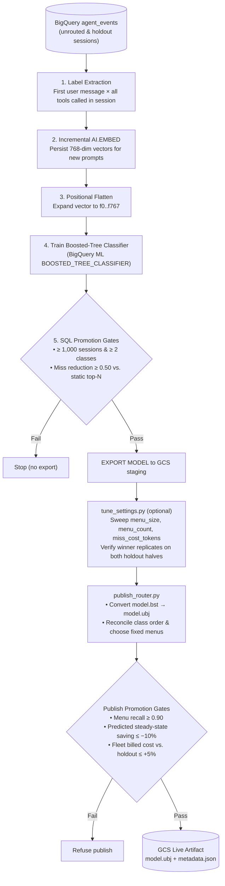

# Training

How a router model gets made: the preflight gates that decide whether it is worth making, the
corpus, the BigQuery pipeline, and the gate a model must clear before it is published.

Every stage on this page has been run end to end, and the artifact it produced went through a live
A/B that measured billed tokens per turn falling 23.4%. Two tool surfaces appear in the numbers
below. The preflight results in [What preflight said](#what-preflight-said) are quoted against a
25-tool reference agent, and everything from
[The corpus and the circularity trap](#the-corpus-and-the-circularity-trap) onward is against the
100-tool agent that replaced it. Running any of this costs real money, mostly in one step. See the
cost table in [`scripts/README.md`](../scripts/README.md).

## Preflight, and why it comes first

The largest unvalidated assumption in this project is that a learned classifier keeps the right
tool in a top-5 set materially more often than a static frequency ranking does. Real agent tool
usage is severely head-heavy. If five tools cover 96 percent of a 25-tool agent's calls, the
correct product is a YAML file and most of this package should be deleted.

So the preflight runs before any of it. Four SQL queries in
[`sql/preflight.sql`](../src/adk_smart_router/sql/preflight.sql) and one Python probe. No plugin
code, no training, no artifacts.

| Gate | What it measures | Go condition |
| --- | --- | --- |
| P5 | Does changing the tool list break the model's cache? | Reported. Its answer reshapes the design. |
| P1 | Distinct tools per session, p50/p90/p99 | p90 at most 5 against 25 tools. |
| P2 | Static frequency baseline coverage@N | Not a gate. It is P3's comparator. |
| P3 | Leave-one-out `VECTOR_SEARCH` k-NN over the embedded prompts | `coverage_knn@5` at least 0.95, and at least 0.10 above static. |
| P4 | Per-tool repeat rate, result identity, stability window | Reported, never gated. |

P5 runs first because it needs no corpus and no infrastructure at all. Everything in the
session-stability chapter rests on the claim that tool declarations sit inside the model's
cacheable prefix. That is verified for ADK's explicit cache, whose fingerprint is a sha256 over
`config.tools`, but explicit caching is off by default, so most deployments run on implicit
caching where tool participation is undocumented.

```bash
uv run python scripts/probe_cache_regime.py --confirm --location global \
  --models gemini-2.5-flash,gemini-3.7-flash --pad-tokens 32000 --control-turns 6
```

P3 is the gate that decides whether the ML stack exists. It measures the classifier's ceiling
without training a classifier, using nothing but embeddings and a vector search. It also proves
the `AI.EMBED` endpoint string, the 768 dimensions, the BigQuery connection and the IAM binding
all work, which is most of the infrastructure risk discharged as a side effect.

P2 must run before P3, because P3 recomputes the baseline internally so that the reported lift is
a difference over one shared denominator rather than two.

## What preflight said

Run on 2026-09-01. P5 cost about $0.45 and needed no data. P1 through P4 ran against the synthetic
corpus: agent `support`, 52,684 events, 1,697 sessions, 2,373 tool calls over 22 distinct tools.

| Query | Result | Verdict |
| --- | --- | --- |
| P5 cache regime | One swapped declaration took cached tokens from 24,888 and 20,170 to zero | Tools are in the implicit prefix |
| P1 distinct tools per session | p90 = 2, max = 4, against 25 tools | Go |
| P2 static frequency baseline | coverage@5 = 0.830 | Below the 0.95 stop, continue |
| P3 leave-one-out k-NN | coverage@5 = 0.982, lift 0.153 | Go, both conditions cleared |
| P4 repeat rates | ran clean, `args_present_rate` 1.0 across all 22 tools | Pipeline test, no TTL adopted |

P5 answered on the side that leaves the design alone. Tools participate in the implicit cache
prefix on both `gemini-2.5-flash` and `gemini-3.7-flash`, so session-stable locking is required in
both cache regimes rather than only under `context_cache_config`.

P3 clears its gate with room: 0.982 against a 0.95 bar, and a 0.153 lift over the static baseline
against a 0.10 bar. So a learned router earns its place on this corpus, which is the question the
whole preflight exists to answer.

Every one of those numbers is provisional, and the reason is in the sentence above: *on this
corpus*. The corpus is synthetic, every row is labelled `synthetic`, and the lift claim stays
blocked on real traffic. A generator and a classifier that both read the same prompt can agree
with each other in ways neither will agree with a real user. Treat P3 as a green light to build,
not as a measurement of the shipped system.

P4 is not a gate and never becomes one. It runs to prove the plumbing. No number it produces may
be written into `cacheable_tools`.

## The corpus and the circularity trap

Training needs labelled data: prompts paired with the tool the agent actually called. There is no
such corpus, so one is generated against the reference agent in
[`examples/reference_agent/`](../examples/reference_agent), a 100-tool customer support agent.
It had 25 tools when preflight ran, which is why the numbers above are quoted against 25.

```bash
uv run python scripts/generate_corpus.py --dry-run
uv run python scripts/generate_corpus.py --confirm --limit 5
uv run python scripts/generate_corpus.py --confirm
```

A second Gemini call plays the customer, the reference agent answers with its real tools, and the
[BigQuery Agent Analytics plugin](https://adk.dev/integrations/bigquery-agent-analytics/), BQAA
below, records what happened. The label is whatever Gemini actually chose
when the agent ran, which is exactly the prediction target in production.

The constraint the whole script exists to protect is that **the generator is blind to the tool
list**. The customer simulator gets a persona and a scenario, and nothing else. No tool name, no
schema, no tool description, no capability list, no expected label. If a tool name reached the
customer prompt the corpus would be worthless, because the preflight would then be measuring how
well we can predict a tool from a prompt written to name that tool. Two assertions enforce it:
one fails the run before any money is spent, and one re-checks the finished prompt string at the
API boundary. There is a `KNOWN_TOOL_NAMES` list in that file, and it exists only to give those
two checks something to compare against.

The router plugin is deliberately not installed during generation. The corpus has to record what
an unrouted agent did, or the classifier learns from its predecessor's pruning.

Everything the corpus produces is marked `corpus_source: "synthetic"`, every downstream preflight
output carries that column and groups by it, and no synthetic run can satisfy a gate silently.
BQAA has no provenance column, so the discriminator is the user id: the generator writes
`user_id = f"corpus-{persona_id}"`, which is where the default `corpus-` prefix in the queries
comes from. Pass the same value to the backtest or the two reports will disagree about which rows
are synthetic.

This is the one step with a real bill. About 1,700 sessions of roughly three turns is about 5,400
Flash turns, and on the 100-tool surface that is roughly $45. The script refuses to start without
`--confirm`, prints a running estimate, and appends a journal line per finished session so a
restart skips what has already been paid for. The finished corpus is committed to the repository
so a fresh clone does not have to regenerate it, as `corpus.jsonl.gz`.

Two things keep that file committable. It is gzipped, and the export leaves out `LLM_REQUEST`
rows. Each of those serializes the whole tool list into its attributes, so on a 100-tool surface
one row is 94 KB and the type as a whole is 89% of the export's bytes. Nothing in this project
reads them: the SQL here reads `USER_MESSAGE_RECEIVED`, `TOOL_STARTING` and `TOOL_COMPLETED`, and
the A/B report reads BQAA's `v_llm_response` view. With them the artifact is 197 MB, which GitHub
refuses; without them it is 7 MB and still contains every row the pipeline queries. The complete
set stays in BigQuery. `provision.sh` unpacks the file before loading, because `bq load` will not
decompress a local `.gz`.

The run that produced the committed corpus cost $45.32 and took two hours of wall clock for
1,700 sessions. Gemini is nondeterministic, so re-running the generator with the same seed produces
a different corpus. The preflight numbers below reproduce from the committed artifact, not from the
seed.

## The training pipeline

[`sql/train_router.sql`](../src/adk_smart_router/sql/train_router.sql) is the whole pipeline for
one agent, as one BigQuery procedure, runnable from a scheduled query:

```sql
CALL `your-project.smart_router.train_router`(
  'your-project',    -- project
  'smart_router',    -- dataset
  'support',         -- agent name, verbatim
  'your-bucket',     -- bucket
  'prod',            -- environment
  NULL,              -- since, or NULL to use lookback
  35);               -- lookback days
```

It runs five stages in order, followed by optional pool tuning and the publisher's promotion gates:



**Label extraction.** Pull the first user message of each session out of the BQAA event tables,
paired with every distinct tool that session went on to call. One session becomes one prompt and
several labelled rows, one per tool in its set, so a multiclass model fit on those rows learns to
rank a session's whole tool set rather than only whichever tool came first. That is the prediction
the router needs, because the tool list is chosen once, before the first model call, and never
revised.

**Incremental embed.**
[`AI.EMBED`](https://docs.cloud.google.com/bigquery/docs/reference/standard-sql/bigqueryml-syntax-ai-embed)
over prompts not already embedded. The vectors are persisted, and
that persistence is what makes the backtest cheap later.

**Flatten.** The 768-dimension array becomes columns `f0` through `f767`. This is not stylistic.
`EXPORT MODEL ... ML_XGBOOST_BOOSTER` renames features by position, so explicit positional
flattening makes the index mapping deterministic instead of relying on undocumented behaviour.

**Train.** One BigQuery ML [boosted-tree
classifier](https://docs.cloud.google.com/bigquery/docs/reference/standard-sql/bigqueryml-syntax-create-boosted-tree).

**Gate, then export.** The promotion gate runs inside the procedure. A model that fails is never
published.

Two placeholders are substituted at deploy time, `@project.@dataset` for where the procedure lives
and `@project.@location.@connection` for the `AI.EMBED` connection. Everything else is a runtime
argument, because a scheduled query cannot template its own SQL. Everything runs under
[Application Default
Credentials](https://docs.cloud.google.com/docs/authentication/provide-credentials-adc), and no
service account key is referenced anywhere in the pipeline.

## The promotion gate

Five criteria. A model that misses any of them is not published. Two of them run in the
training procedure and decide whether a model is exported at all; the rest run at publish
time, for the reason in [the section below](#where-each-criterion-runs).

| Criterion | Threshold | Where it runs |
| --- | --- | --- |
| Recall, the tools a session wanted are in the menu it gets | at least 0.90 | `publish_router.py` |
| Share of the static baseline's misses that the model removes | at least 0.50 | `train_router.sql` |
| Predicted steady-state saving | at most −10% | `publish_router.py` |
| What the fleet has actually been billed to prune | no worse than +5% against holdout | `publish_router.py` |
| Data sufficiency, sessions and surviving classes | at least 1,000 sessions and 2 classes | `train_router.sql` |

The second criterion is the one that justifies the project existing. Coverage of 0.98 means
nothing on its own, because "keep the seven most-used tools" might also score 0.98. If it does,
then the embedder, the model store, the predictor, all the training SQL and the parity contract
are dead weight, and the correct product is a YAML file. The model has to re-prove it beats the
dumb thing on every single retrain, not just the first one.

It is a *relative* figure, the share of the baseline's misses the model removes, and not the
absolute gap between the two coverages. That distinction is not cosmetic. Both criteria depend on
how many tools are kept, in opposite directions: a longer list raises coverage and shrinks the
absolute gap, because the static ranking catches up faster at the top of the curve than the model
does. An absolute bar of 0.10 therefore cannot be satisfied alongside criterion 1 at any N. The
curve is in [the section below](#why-criterion-2-is-relative). The relative figure sits between
0.78 and 0.84 across N=3 to N=12, so it measures the model rather than how hard the baseline's job
happens to be.

Two metrics are logged and neither gates: abstain precision, which has no subject now that there is
no abstain action, and macro recall, which is a proxy for something criterion 1 measures directly.
A collapsed model that still puts the right tool in the top 5 is doing its job.

### Where each criterion runs

Criterion 1 runs in `publish_router.py` rather than in the training procedure, and it has to,
because the router does not serve the raw top-N ranking. It snaps that ranking to one of eight
menus, and the menu is better than the ranking it came from, because a menu holds tools that travel
together and so carries a session's second and third tool along with its first. On the reference
agent the raw top-7 covers 0.9785 and the menu the router actually sends covers 0.9895. A gate in
the SQL measures the list the router never sends, and rejects models that pass the criterion.

BigQuery cannot measure the right number. The menus are chosen in Python, from the training half of
the corpus, at publish time. So criterion 1 runs where the menus exist, against the converted
booster, the reconciled class order and the exact menu pool about to be written. It reports two
figures: recall over every held-out session that wanted a tool, counting a declined session as a
hit because a decline ships the full list, and recall over the routed sessions alone as a
diagnostic. The first is what gates, at 0.90.

The bar is 0.90 and not 0.98 because 0.98 is a bar no artifact this project has produced would
clear, including the one it serves. A default that rejects everything is not a safe default, it is
a broken one. `DEFAULT_MIN_MENU_RECALL` in `publish_router.py` is the single definition, and
`tune_settings.py` imports it rather than keeping its own copy, so the two cannot drift.

Measuring it there has a second benefit that the SQL version could never have. It is the only
check in the pipeline that runs the booster after conversion and after label reconciliation, so
it is the only thing that would catch a reversed class list before the artifact ships.

### Criterion 1 when there are no menus

Everything above assumes menus. When `plan_menus` finds none, criterion 1 has no subject, and the
obvious fallback is `coverage` from the run record. That is a strict top-N cut, and it is not what
the router serves on that path. Without menus the
pruner keeps labels in rank order until their cumulative probability reaches
`keep_probability_mass`, so it usually stops short of N. On the reference artifact the strict cut
covered 0.9889 and the rule that actually ships covered 0.9263, a gap of six points that nothing
in the pipeline could see.

So `train_router.sql` measures both. `coverage` feeds criterion 2. `coverage_mass` scores the same
holdout under the pruner's exact rule, including the fact that ABSTAIN takes a slot, and rides into
`gate_metrics` alongside the `keep_probability_mass` it was measured at. `gate_mass_coverage` in
`publish_router.py` holds a menu-less publish to the same 0.90 bar criterion 1 uses, so the path is
gated rather than merely reported. A run whose record carries no `coverage_mass` reads as
unmeasured and gates on nothing, which is the same distinction the rest of the script draws between
an absent number and a bad one.

Criterion 3 runs in the same place and on the same replay, because it is the other half of
criterion 1. Recall only ever refuses in one direction, and the cheapest way to a perfect recall
is to decline every session and ship the whole tool list every time. That artifact is completely
safe and completely pointless, and only criterion 3 can say so. It is the predicted saving the
artifact would deliver in steady state, in the same unit as the live metric:

```
predicted saving = −0.1 × Σ (declaration tokens removed × turns) / Σ billed input tokens
```

summed over held-out sessions, where a declined session removes nothing and so pays into the
denominator only. Pricing a prune means knowing what a declaration costs, which is a property of
the agent rather than of the router, so pass `--declaration-tokens`:

```bash
uv run python scripts/measure_menus.py --dump-tokens tokens.json
uv run python scripts/publish_router.py --declaration-tokens tokens.json --dry-run
```

Without that file nothing can be priced, and the gate says it did not measure rather than
measuring a zero and refusing everything.

The denominator counts only the held-out sessions that were actually billed for the whole tool
list, which the publisher decides by asking whether every prompt in the session was at least as
large as the full set of declarations. That sounds fussy and it is the difference between a
believable number and a useless one. A corpus window wide enough to train on will usually span
some history: an older, smaller tool surface, or the routed arm of an experiment whose prompts a
router had already pruned. Neither is a baseline for what pruning saves. On the reference agent,
including them claimed −76% for an artifact worth −43%.

Two things to know when you read the number. It is an upper bound, because it is defined on the
steady state and a corpus is the steady state, with a warm prefix on nearly every turn; the
reference artifact predicts −43% here and measured −23.4% in a live A/B, and that gap is turn one,
not model quality. And the gate declines to vote when fewer than 100 held-out sessions qualify,
because a release refused on twenty sessions is a release refused on noise. It still prints the
number and still writes it into the artifact as `predicted_g1`, beside the `routed_share` that
explains it.

Criterion 4 is the only one that is not a replay. The three above all ask the artifact to predict
its own future on held-out traffic, and a replay cannot see the implicit cache, which is the
mechanism by which a good prune turns into a bad bill. So this one reads the past instead: what
every replica of this agent was actually billed over the last thirty days, routed against holdout,
later calls only, cached tokens at a tenth. If pruning has been costing more than not pruning by
more than the margin the live cache guard demotes at, publishing a new artifact on top of it is
guessing at a question production has already answered, and the publish is refused.

It is the same measurement `scripts/fleet_cache_watch.py` prints, and the same comparison the
in-process cache guard makes; `docs/operations.md` has the operator's view of both. An agent with
no holdout arm, or a fleet too thin for any single replica to reach the sample floor, is reported
as unmeasured and publishes. `--skip-fleet-gate` skips the read.

Coverage still gates inside the procedure, adaptively, through criterion 2. With the eval
baseline at 0.8958, `miss_reduction >= 0.50` means coverage cannot fall below about 0.948
without failing, and the floor rises on its own if the baseline gets easier. What the procedure
now refuses outright is a run with no eval coverage at all, which means the eval split came back
empty and every other number on the row is meaningless.

### Why criterion 2 is relative

Both criteria move with `max_tools_kept`, and they move in opposite directions. Here is the trained
model's coverage as a function of how many tools are kept, beside the static ranking at the same N,
on the 25-tool reference agent:

| N | Model | Static | Lift | Coverage ≥ 0.98 | Lift ≥ 0.10 |
| --- | --- | --- | --- | --- | --- |
| 3 | 0.9317 | 0.6255 | 0.3062 | no | yes |
| 4 | 0.9539 | 0.7934 | 0.1605 | no | yes |
| 5 | 0.9649 | 0.8321 | 0.1328 | no | yes |
| 6 | 0.9742 | 0.8727 | 0.1015 | no | yes |
| 7 | 0.9852 | 0.9096 | 0.0756 | yes | no |
| 8 | 0.9871 | 0.9170 | 0.0701 | yes | no |
| 10 | 0.9908 | 0.9410 | 0.0498 | yes | no |
| 12 | 0.9926 | 0.9613 | 0.0313 | yes | no |

No row satisfies both an 0.98 coverage bar and an 0.10 absolute lift bar. Coverage crosses 0.98
between N=6 and N=7, and lift crosses 0.10 in the same gap from the other side. Raising
`max_tools_kept` buys coverage by giving away lift, because a longer static list catches up faster
at the top of the curve than the model does. There is nowhere to put the dial where both hold.

Neither threshold is unreasonable alone. Together they are infeasible, and the reason is that
absolute lift is the wrong question. Adding one column shows what to ask instead:

| N | Static misses | Model misses | Misses removed |
| --- | --- | --- | --- |
| 3 | 37.5% | 6.8% | 0.82 |
| 4 | 20.7% | 4.6% | 0.78 |
| 5 | 16.8% | 3.5% | 0.79 |
| 6 | 12.7% | 2.6% | 0.80 |
| 7 | 9.0% | 1.5% | 0.84 |
| 8 | 8.3% | 1.3% | 0.84 |
| 10 | 5.9% | 0.9% | 0.84 |
| 12 | 3.9% | 0.7% | 0.84 |

The last column barely moves while absolute lift swings by a factor of ten. That is the tell:
absolute lift reports how hard the baseline's job is as much as how good the model is. So criterion
2 is the relative figure at a 0.50 bar, and `max_tools_kept` is 7 on that surface, which is where
coverage clears 0.98. Two extra declarations out of 25, and pruning still removes 18 of them.

For scale on the coverage bar: P3's leave-one-out k-NN puts the ceiling at 0.9825, and it excludes
same-session neighbours, so that number is not inflated by leakage. An 0.98 bar asks a boosted tree
trained on 4,085 rows to come within a quarter of a point of a nearest-neighbour oracle with the
whole corpus to draw on. At N=5 the model reaches 98.2% of that ceiling.

### The eval split decides whether any of this compares

Send every session that touches a rare class to the training side, so those classes stay learnable,
and the eval split comes out head-heavier than the corpus. A static ranking gains more from that
than a classifier does, because rare tools are exactly where "keep the five most-used" fails, and
the gate then measures the split rather than the model: static top-5 reads 0.8926 on such an eval
split against 0.8297 over the whole corpus, six points of pure artifact.

The shipped rule puts the rare-class floor at 10 rows and the eval share at 25%, which brings the
eval baseline to 0.8321 against the corpus's 0.8297. Change either and re-measure the baseline
before comparing a model to anything.

### Reading these numbers

Everything in the two sections above is measured on the 25-tool reference agent, against a
synthetic corpus. Read it as evidence that the pipeline is correct end to end and that the gate
refuses on its own, not as a claim about how much the router saves. The saving claims are in
[the README](../README.md) and come from live A/B runs.

On the 100-tool surface the shape changes a long way. `max_tools_kept` is 11, the static baseline
falls to 0.762, the model's lift over it triples to +0.170, and no setting reaches the 0.98
coverage the 25-tool numbers take for granted.

## Backtesting instead of shadow mode

There is no shadow mode. [`sql/backtest.sql`](../src/adk_smart_router/sql/backtest.sql) computes
what shadow mode would have measured, over months of history, at zero hot-path cost.

It reports coverage@N of the trained model against the static baseline, split by `corpus_source`
and by arm, per ISO week so a trend is visible. Beside them it reports `miss_reduction`, the same
quantity the promotion gate's criterion 2 uses, so the rollout gate G2b and the promotion gate read
the same number. The holdout arm is reported separately because it is the only unbiased corpus.
Pass `RouterConfig.max_tools_kept` as `top_n`, or the numbers do not compare to the gate.

The procedure never calls `AI.EMBED`. It reuses the vectors training already persisted, which is
what turns a months-long window into a table scan rather than a $45 embedding bill. Rows with no
persisted vector cannot be scored, so they are counted rather than dropped, because a silent drop
would bias the very coverage number being reported.

Shadow mode was rejected for a second reason as well. `route_fraction` gives a real A/B on cost
and latency, which shadow structurally cannot produce, because shadow never changes the request.

### Running it

```bash
./scripts/deploy_sql.sh src/adk_smart_router/sql/backtest.sql

bq query --use_legacy_sql=false "
CALL \`\${PROJECT}.smart_router.backtest_router\`(
  '\${PROJECT}', 'smart_router', 'support',
  NULL, 180,                                    -- since, or NULL to use a 180-day lookback
  11,                                           -- top_n: RouterConfig.max_tools_kept
  0.05,                                         -- holdout_fraction
  'corpus-',                                    -- the corpus generator's user id prefix
  TIMESTAMP '2026-07-28 16:08:59')              -- router_training_runs.corpus_since
"
```

Two of those arguments are wrong by default in a way that produces a confident wrong answer rather
than an error, so check both before you believe the output.

`synthetic_user_prefix` must match what `generate_corpus.py` writes, which is `corpus-`. Pass
anything else and every row reports as `corpus_source = production`, so a table of synthetic
results reads as a table of real ones.

`trained_since` must be `router_training_runs.corpus_since`. Pass NULL and `overlaps_training` is
`false` on every row, which reads as "none of this is in-sample" when the opposite is usually
true. The flag exists so you can tell a backtest from a memory test.

Results are appended to `smart_router.router_backtest`, one row per week per corpus source per
arm, keyed by `run_id`.

## Publishing an artifact

`EXPORT MODEL` writes the booster to `routers/{agent}/{version}/` in the bucket. Five objects land
there: `model.bst`, `assets/model_metadata.json`, and three Agent Platform extras the router does not use.
Neither of the two files the loader looks for is among them, so that directory is inert.

```bash
uv run python scripts/publish_router.py --dry-run
uv run python scripts/publish_router.py --confirm
```

[`scripts/publish_router.py`](../scripts/publish_router.py) turns the export into an artifact. It
does five things, and the first three exist because of something that would otherwise fail
silently.

**It converts the booster.** `model.bst` is XGBoost's pre-1.0 binary format, and XGBoost removed
the ability to read that in 2.1. The version this project serves with does not open it degraded, it
raises. Carrying an EOL XGBoost into the serving process to work around that would be the wrong
trade, so the conversion happens once, here, in a throwaway environment:
[`scripts/convert_booster.py`](../scripts/convert_booster.py) runs under
`uv run --isolated --no-project --with xgboost==1.7.6` and rewrites the trees as `model.ubj`. The
publisher then loads that result with the *installed* XGBoost, which is the check that the
conversion produced something this project can actually read.

**It writes `metadata.json`.** Every field in it is validated on load: `version`, `sha256`,
`size_bytes`, `trained_at`, `rows`, `classes`, `backend`, `environment`, `embedding_model`,
`embedding_dims`, `gate_metrics` and `menus`. A missing or malformed field is a refusal rather
than a warning, and an unparseable `trained_at` reads as infinitely old so a broken artifact
demotes itself rather than passing the freshness check by accident. `menus` is the only optional
one: an artifact without it routes per session, as every artifact did before menus existed. A
`menus` that is present and malformed is still a refusal. Two of the fields cannot come from
BigQuery at all:
`sha256` and `size_bytes` are properties of the blob, and SQL has no way to stat one. They cover
the converted bytes, because those are the bytes serving downloads.

**It decides the label order**, which is the reason this is a script and not a shell one-liner. The
order of `classes` is the model's label mapping, because `predictor.py` zips it against the
booster's probability vector by position. BigQuery writes `router_training_runs.classes` in
ascending order and the export writes `class_names` in descending order. Publishing the wrong one
reverses the mapping: every prediction wrong, the digest still valid, nothing raised anywhere. So
the order comes from the exported assets and the run record is used only as a set to check it
against. The script also confirms the features are `f0` through `f767` in order, checks the booster
emits one probability per class, and runs the finished metadata through the loader's own validator
before writing a byte.

**It chooses the menus.** This is the one part that is not a safety check. The router does not
assemble a bespoke tool set per session, because that fragments the context cache
([architecture](architecture.md#menus-and-why-the-kept-set-is-not-bespoke)); it snaps each
decision to one of a handful of fixed menus, and those menus are chosen here. The publisher makes
a second pass over the corpus, over the same window the booster trained on, and asks
`adk_smart_router.menus.choose` for the set of menus that covers the most tool calls. Only tools
the booster can actually predict are eligible, since a slot spent on anything else can never be
chosen on purpose. Menus are written sorted so that two publishes can be diffed.

This step never refuses. A corpus with nothing usable in it publishes an empty list, and the
router falls back to deciding per session, which is what it did before menus existed. Blocking a
good booster over an optional field would be the wrong trade. `--no-menus` skips the pass, and
`--menu-size`, `--menu-count` and `--menu-lookback-days` control it.

You do not have to pick those numbers by hand. `scripts/tune_settings.py` chooses them from the
agent's own logged sessions and writes the choice to a file:

```bash
uv run python scripts/tune_settings.py --out settings.json
uv run python scripts/publish_router.py --settings settings.json --dry-run
```

Precedence is explicit flag, then the file, then the shipped default, and publishing prints where
each value came from. Settings tuned for one agent are refused for another, since a pool shape is
a claim about one tool surface. See [the tuner](#tuning-the-pool-shape) below for what it measures
and when it declines to answer.

**It runs the two gates that need the menus**, criterion 1 and criterion 3, against the converted
booster and the pool it is about to write. Both are described in
[the promotion gate](#the-promotion-gate) above; criterion 3 needs `--declaration-tokens` to be
measurable at all.

Then it reads the artifact back through `ModelStore` exactly as serving will. Writing a file the
reader rejects is the one outcome the publisher must not have, and the reader is right there.

There is no `latest.json` pointer. A version directory counts as publishable only once both
`metadata.json` and `model.ubj` are present, so atomicity comes from completeness rather than from
getting the write order right, which is why `metadata.json` is written last. Bucket versioning is
on, which is what makes a bad artifact roll back by generation.

The serving side verifies environment first, then size before pulling any bytes, then the sha256
digest before handing the file to xgboost. Environment comes first because a cross-environment
path collision means staging serves production.

## Checking the artifact end to end

Every check up to here happens where the thing being checked was produced. The gate metrics were
measured inside BigQuery, where the label mapping is correct by construction. The publisher checked
the artifact against the export. Nothing has yet run the whole chain in one process.

```bash
uv run python scripts/check_router.py                   # full path, a cent or so
uv run python scripts/check_router.py --skip-embedding  # model only, free
```

[`scripts/check_router.py`](../scripts/check_router.py) loads the published artifact through
`ModelStore`, hands it to `Predictor`, and scores it on held-out rows using the same session-hash
split training used. It scores twice: once on the vectors BigQuery already computed, which isolates
the model and the label order, and once on the same prompts re-embedded through `Embedder`, which
is the real hot path. Then it compares both against the run record.

The first number is the one that catches a reversed label order. Coverage can stay respectable
under a wrong mapping, because a top-7 window catches the right tool by accident often enough to
look plausible. Top-1 cannot: it collapses to roughly chance, and the script fails below 0.20.

On the published `support` router:

| | n | top-1 | top-7 coverage |
| --- | --- | --- | --- |
| Stored vectors | 150 | 0.6533 | 0.9867 |
| Re-embedded | 150 | 0.6533 | 0.9867 |

Recorded coverage for that run was 0.9852, so a 150-row sample lands 0.0015 away. The two rows are
identical to four decimal places, which is the train/serve parity claim demonstrated rather than
argued: the same prompts, embedded twice by two different stacks, rank the same way.

## Tuning the pool shape

The menu size, the menu count and the miss price can be chosen by hand, by reading a table. That
does not survive an agent whose tool surface changes, and it does not survive being installed
somewhere nobody is reading tables. `scripts/tune_settings.py` does the reading.

It sweeps the three numbers, fits each candidate pool on a training split, assigns menus on the
held-out split with the published model through the same code the plugin runs, and prices each
result against the agent's own logged arrival times. What it produces is a frontier: how much
saving each pool buys, and how much menu recall it gives up to buy it.

```bash
uv run python scripts/tune_settings.py --session-prefix corpus --out settings.json
```

Three things about reading its output.

**The recall bar is the only input that is not a measurement.** Everything else the tuner prints is
arithmetic on logged traffic. The bar is a statement about how much recall you will sell and for
how much saving, and the answer moves whenever that willingness does. So the tuner prints which
pool wins at each bar rather than just the winner at yours. On the reference agent the exchange
rate is about three points of saving per point of recall.

**The saving it predicts is a floor.** It scores a sample of the traffic, and replaying a sample at
the full traffic's arrival rate restores the rate but not the volume. A prefix is cold on its first
arrival however fast the sessions come, so a sample under-warms every pool. Measured on the
reference agent this is worth three to four points, near enough uniform across candidates that it
changes the ranking not at all. Trust the order, treat the level as a lower bound.

**It will decline to answer.** After picking, it splits the held-out sessions in two and sweeps
again on each half. If the same candidate does not win on both, it writes nothing and says so,
because a sweep over a few dozen candidates always returns a winner and the winner always looks
like a finding. A tuner that moves settings on a slow week is worse than one that never runs.
`--write-unstable` overrides it once you have read the frontier yourself.

## Parity, one more time

Training embeds with BigQuery `AI.EMBED`. Serving embeds with `google-genai`. If those two produce
different vectors, the model clears every gate on this page and predicts garbage in production,
with no error raised anywhere. It is the quietest failure in the system.

The fields both sides read are marked "parity" in `config.py` and are single-sourced: one field
used on both sides, never one field per side. The serving client is pinned with `vertexai=True`,
because `google-genai` otherwise defaults to the Gemini Developer API, which returns the same model
name, the same dimensions, no error, and different vectors. Truncate then normalize, in that
order, on both sides.

If you change the embedding model, the dimensions, the task type or the normalization order, change
them in `config.py` and in `sql/train_router.sql` in the same commit, and retrain before deploying.

## Retraining

A retrain is three steps in a fixed order, and
[`scripts/retrain.sh`](../scripts/retrain.sh) is all three:

```bash
./scripts/retrain.sh              # dry run: trains nothing, publishes nothing
./scripts/retrain.sh --confirm
```

It calls `train_router`, then `tune_settings.py`, then `publish_router.py`. What it adds over
running those by hand is what each step does when the one before it declines.

If the gate rejects the model, no booster is exported and the script stops. It knows because it
reads the newest gate-passing run id before and after training and compares them. Without that
check, publishing would happily re-ship the booster that is already live under a new version
number, which looks like a successful retrain and is not one.

If the tuner declines, the previous settings stay. A refusal means the recommendation did not
replicate on both halves of the held-out traffic, so the honest response is to keep last week's
answer, not to fall back to the shipped defaults and silently undo a real tuning. The settings
file is the only place that answer is written down, so on a throwaway runner point `--settings`
at something durable.

One ordering note. The tuner reads the currently published model and the publisher ships the
newly trained one, so a recommendation applies to the generation after the one it was measured
on. That is a lag rather than a leak: the pool shape is fit from traffic, and the model only
decides which menu a session lands in. On a steady cadence it costs one cycle.

Nothing here restarts the agent, and nothing needs to. Every running process re-reads the bucket
every `refresh_interval_s`, 900 seconds by default, and picks the new artifact up on its own. So a
publish reaches the fleet within about a quarter of an hour of finishing. Set
`max_model_age_days` a little above your retrain cadence anyway: it is the backstop for a process
whose re-poll cannot reach the bucket at all, which demotes itself to passthrough rather than
serving a stale model.

### Running it on a timer

`retrain.sh` retrains whatever it is pointed at, every time it is run.
[`scripts/run_cycle.sh`](../scripts/run_cycle.sh) is the wrapper that decides whether to:

```bash
./scripts/run_cycle.sh --confirm --agent support
```

It asks `check_drift.py` whether the published model still fits the surface it is serving, stops
when it does, and calls `retrain.sh` when it does not, under the same cycle id so the verdict and
the retrain it caused are one row in `v_router_cycles`. Running it daily does not mean retraining
daily: a minimum of seven days between cycles is read out of the ledger, so two triggers in one
day retrain once. [docs/operations.md](operations.md) has the Cloud Scheduler recipe and the
generation watch that runs beside it.

### What a retrain costs

**$0.11 and five minutes**, for a 9,043-row corpus, measured from the billing export by job id
rather than estimated. The run is 48 BigQuery jobs billing 18.8 GB, and 74% of that is the
`CREATE MODEL` alone: 13.8 GB, $0.079, 7,694 slot-seconds.

It is all BigQuery Analysis at the on-demand per-TiB rate. No separate training charge appears
against a boosted-tree `CREATE MODEL` at all, which is worth stating because the opposite is easy
to assume from the documentation: `BOOSTED_TREE_CLASSIFIER` is an EXTERNAL model type, and EXTERNAL
model types are usually the ones that bill outside BigQuery. This one does not.

Embedding is charged separately, on [Gemini
Enterprise](https://cloud.google.com/gemini-enterprise-agent-platform/generative-ai/pricing), and is
incremental. `train_router` only embeds rows
that have no vector yet, so the first run over a back catalogue is a one-time cost proportional
to the corpus and every run after it pays only for new traffic. That is why the number above is
so flat: a steady-state retrain on unchanged traffic embeds nothing.

So cadence is not a cost decision. Daily is about $3 a month on a corpus this size. Pick the
cadence from how fast your traffic moves and from `max_model_age_days`, not from the bill.

### What the retrain is allowed to read

Production traffic is traffic the router shaped. A session that was pruned could only call the
tools it was left with, so its tool set is not what the session wanted, and learning from it
teaches the next model to agree with this one.

Both the training SQL and the tuner drop those sessions, using the same test: a router record
whose `decision_source` is `fresh` or `reused` means a prune really happened. What
survives is the permanent holdout arm plus the sessions the decline rule passed through, and
that is why the holdout stays at 5 percent forever rather than being ramped away.

The filter removes nothing from the generated corpus, because nothing there was routed. It
starts mattering the first time either script is pointed at live traffic.
